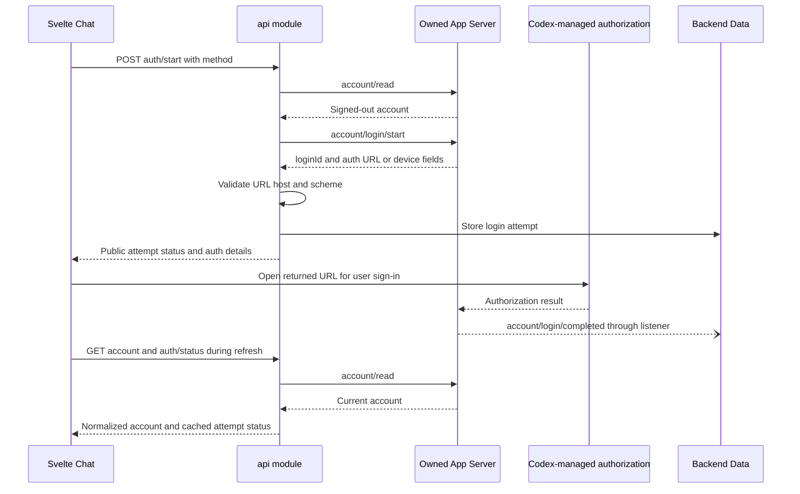
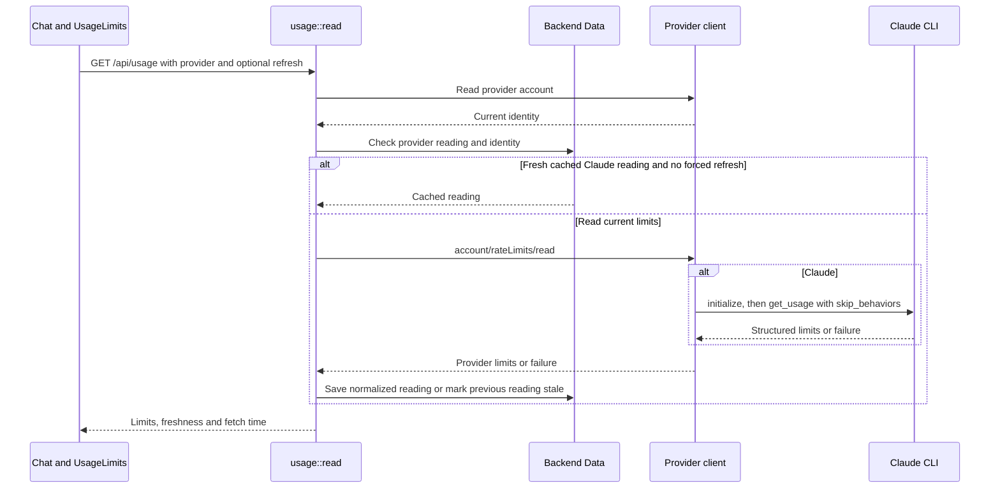

# Codex-managed sign-in

[Account and usage](README.md)

OAuth runs inside Codex; this diagram does not specify its token exchange. Login
completion may precede the start reply. `login_results` reconciles that ordering.
The account read, not a successful popup navigation, authorizes later chat requests.

| Participant | Source |
| --- | --- |
| Svelte Chat | [chat.svelte.ts](../../web/src/chat.svelte.ts): `signIn`, `refresh`, `cancelLogin`. |
| API | [api.rs](../../server/src/api.rs): `login`, `read_account`, `auth_url`, `login_status`. |
| Codex transport | [rpc.rs](../../server/src/rpc.rs): `Client::call` and notification routing. |
| Backend Data | [chat.rs](../../server/src/chat.rs): login notification handling in `Backend::new`. |

## Provider limits

| Participant | Source |
| --- | --- |
| Chat and UsageLimits | [chat.svelte.ts](../../web/src/chat.svelte.ts): `refreshUsage`, `usage`; [UsageLimits.svelte](../../web/src/UsageLimits.svelte). |
| usage::read | [api/usage.rs](../../server/src/api/usage.rs): authorization, cache selection, normalization. |
| Provider client | [providers.rs](../../server/src/providers.rs): `provider_client`; [claude.rs](../../server/src/claude.rs): `serve`, `Bridge::usage`. |
| Backend Data | [chat.rs](../../server/src/chat.rs): per-provider `usage` map. |

The Codex client answers through the owned App Server. The Claude client delegates the
read to its CLI. Both provider refreshes can run concurrently; neither starts a chat turn.
