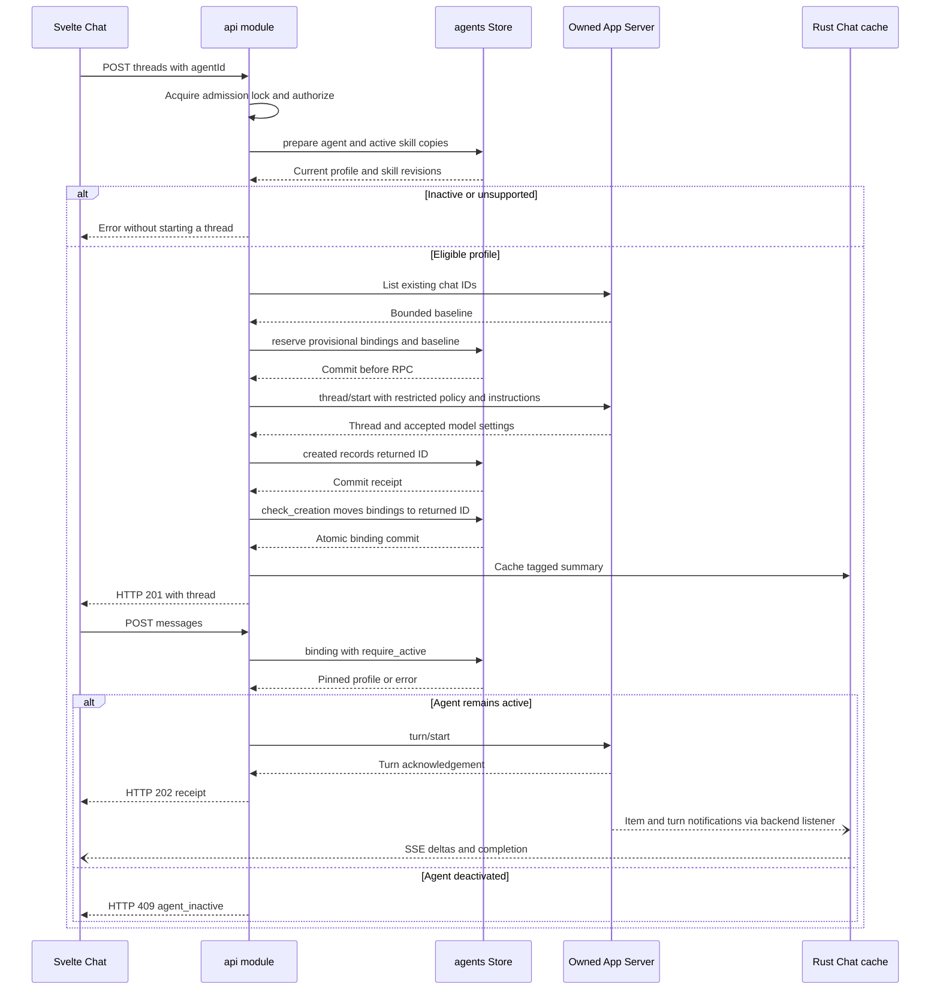
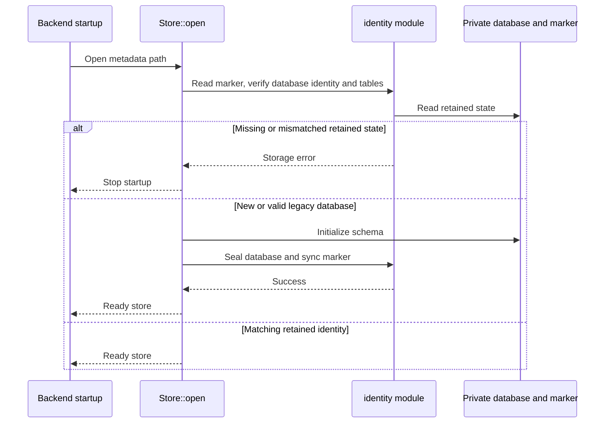

# Direct agent chat

This sequence covers an activated text-only profile and unchanged authentication.
Profile editing and stored fields are described in the [capability page](README.md).

Codex notifications can arrive before the turn acknowledgement. The existing event
buffer handles that ordering; HTTP and SSE delivery are independent. A failed binding
move leaves the receipt for retry on listing or loading, without another creation.
Without a returned ID, unfamiliar history stays blocked. Thread creation and the local
database are not one transaction.

## Storage startup

Sources: [Store::open](../../server/src/agents.rs),
[identity](../../server/src/agents/identity.rs).
After identity checks, [creation::migrate](../../server/src/agents/creation.rs)
creates the journal and admission records once or verifies their tables exist.

## Source map

| Participant | Implementation |
| --- | --- |
| Svelte Chat | [chat.svelte.ts](../../web/src/chat.svelte.ts): `chooseAgent`, `create`, `send`, event subscription. |
| API | [api.rs](../../server/src/api.rs): `create`, `send`, `save_agent`, `load`. |
| Store | [agents.rs](../../server/src/agents.rs): `prepare`, `reserve`, `binding`, `save`; [creation.rs](../../server/src/agents/creation.rs): receipts and recovery. |
| Owned App Server | [runtime.rs](../../server/src/runtime.rs): `launch`; RPC transport in [rpc.rs](../../server/src/rpc.rs). |
| Rust Chat cache | [chat.rs](../../server/src/chat.rs): notification listener and per-chat state. |
