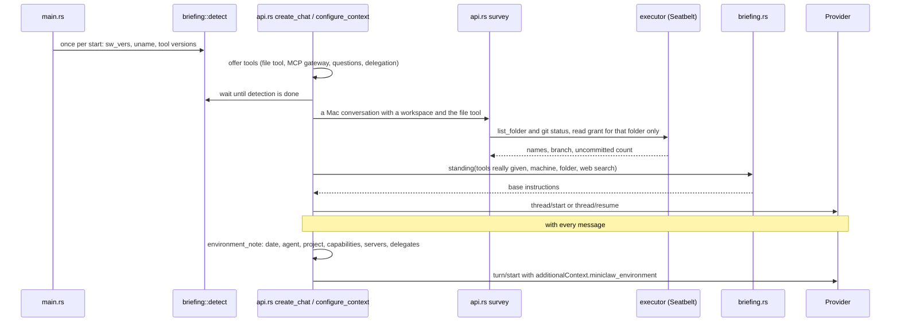

# Briefing: sequence

Back to [What a model is told about where it is](README.md).

| Participant | Source |
|---|---|
| detect | [`briefing.rs`](../../server/src/briefing.rs) `detect`, `first_line` |
| create_chat / configure_context | [`api.rs`](../../server/src/api.rs) `brief`, `environment_note`, `send` |
| survey | [`api.rs`](../../server/src/api.rs) `survey` |
| briefing.rs | [`briefing.rs`](../../server/src/briefing.rs) `standing`, `state` |
| Claude | [`claude.rs`](../../server/src/claude.rs) `instructions`, `begin` (the note joins the system prompt) |

The diagram's syntax was not checked with a renderer.
