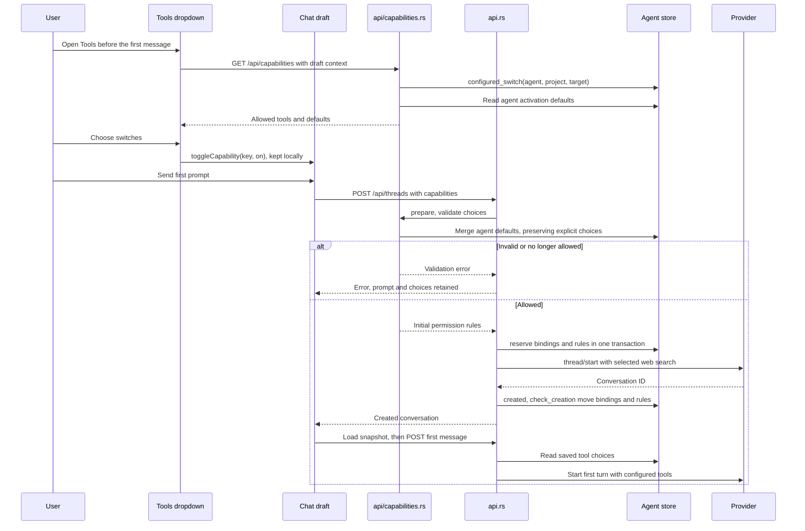
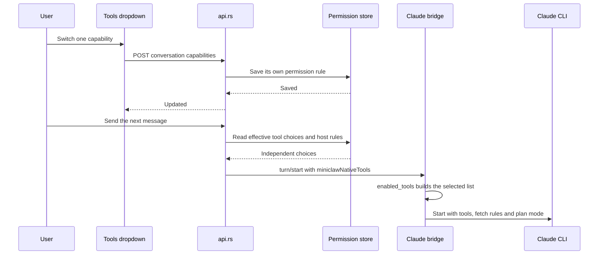
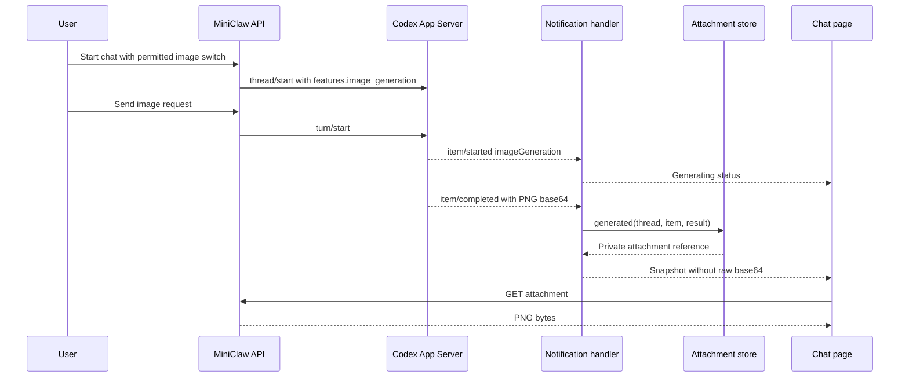
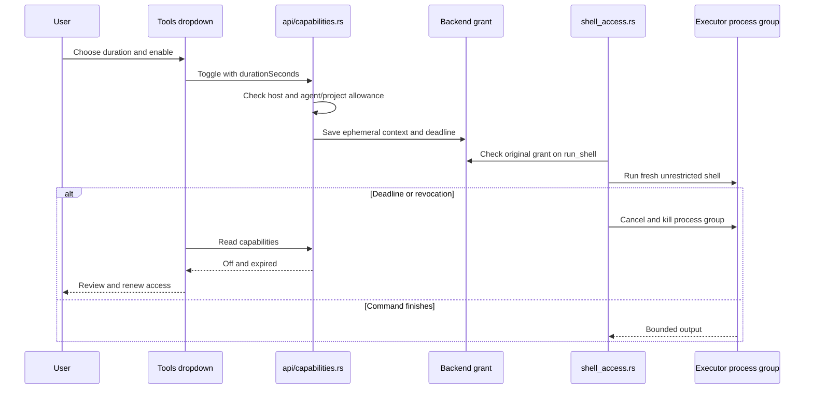

# Capabilities: sequence

Back to [Capabilities](README.md).

| Participant | Source |
|---|---|
| Tools dropdown | [`Capabilities.svelte`](../../web/src/Capabilities.svelte) |
| Chat draft | [`chat.svelte.ts`](../../web/src/chat.svelte.ts) `toggleCapability`, `create`, `send` |
| api/capabilities.rs | [`api/capabilities.rs`](../../server/src/api/capabilities.rs) `list`, `prepare`, `initial_defaults` |
| api.rs | [`api.rs`](../../server/src/api.rs) `create_chat`, `send` |
| Agent store | [`capability_defaults.rs`](../../server/src/capability_defaults.rs) `capability_defaults`, [`agents.rs`](../../server/src/agents.rs) `reserve`, [`agents/creation.rs`](../../server/src/agents/creation.rs) `created`, `check_creation`, [`permissions.rs`](../../server/src/permissions.rs) `configured_switch`, `permission` |
| Provider | [`rpc.rs`](../../server/src/rpc.rs) `Client::call`, [`claude.rs`](../../server/src/claude.rs) |

The original diagrams were rendered on 2026-09-22; the activation-default update has not been rendered.

## Claude tool selection

| Participant | Source |
|---|---|
| Tools dropdown | [`Capabilities.svelte`](../../web/src/Capabilities.svelte) |
| api.rs | [`api/capabilities.rs`](../../server/src/api/capabilities.rs) `toggle`, [`api.rs`](../../server/src/api.rs) `claude_tools`, `send` |
| Permission store | [`permissions.rs`](../../server/src/permissions.rs) `permission`, `set_permission` |
| Claude bridge and CLI | [`claude.rs`](../../server/src/claude.rs) `NativeTools::read`, `enabled_tools`, `Bridge::command` |

## Image generation

API: [`api.rs`](../../server/src/api.rs) `create_chat`, `send`; notifications:
[`chat.rs`](../../server/src/chat.rs) `clean_image_notification`, `Chat::notify`; storage:
[`attachments.rs`](../../server/src/attachments.rs) `generated`; page:
[`App.svelte`](../../web/src/App.svelte), `MessageFiles`. This added diagram was checked
against source but has not been rendered.

## Timed shell access

Source: `toggle_shell` and `list` in api/capabilities.rs, `run_unrestricted` in shell_access.rs,
`execute_unrestricted` and `ProcessGroup::drop` in executor.rs. Diagram not visually rendered.
