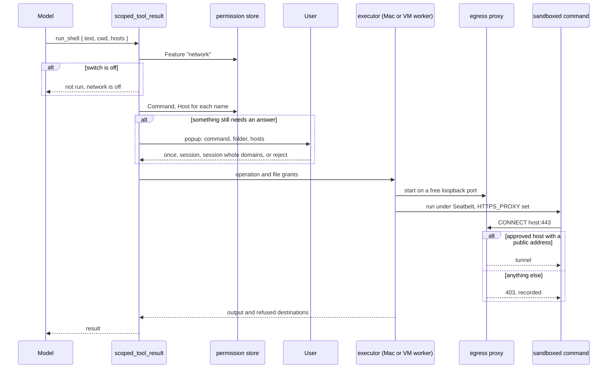

# Network for shell commands sequence

| Participant | Source |
| --- | --- |
| scoped_tool_result | [chat.rs](../../server/src/chat.rs) `scoped_tool_result`, `ScopedApproval` |
| permission store | [permissions.rs](../../server/src/permissions.rs) `Target`, `decide`, `dns_name`, `parent_domain` |
| executor | [executor.rs](../../server/src/executor.rs) `execute_host_resolving`, `command`; [seatbelt.rs](../../server/src/seatbelt.rs) `profile_with` |
| egress proxy | [egress.rs](../../server/src/egress.rs) `Proxy`, `serve`, `system_resolver`, `private` |
| popup and switch | [App.svelte](../../web/src/App.svelte), [PermissionSettings.svelte](../../web/src/PermissionSettings.svelte) |

Back to [Network for shell commands](README.md).
