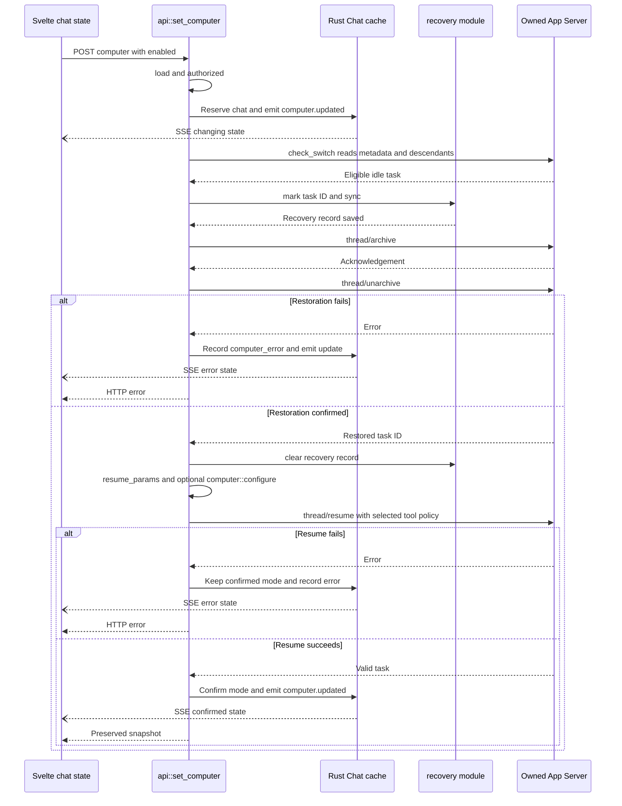
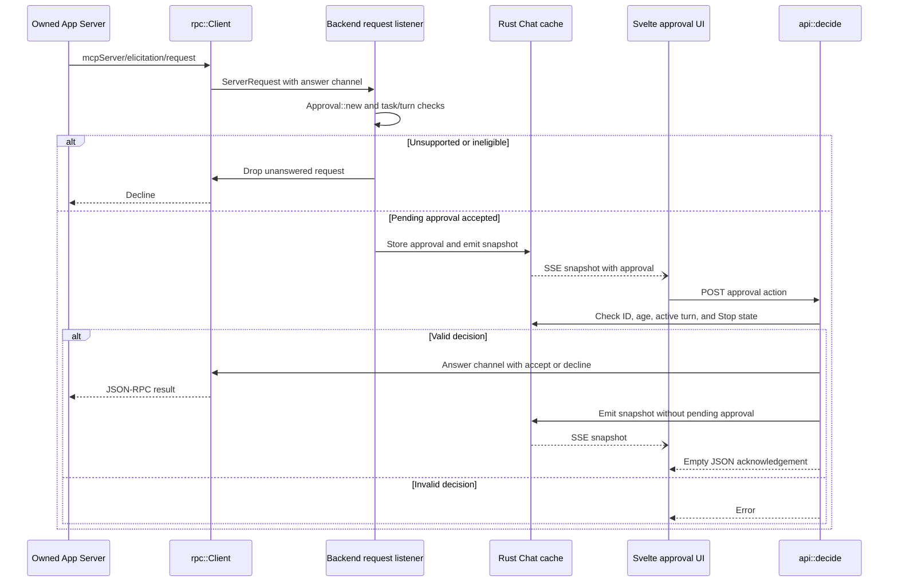
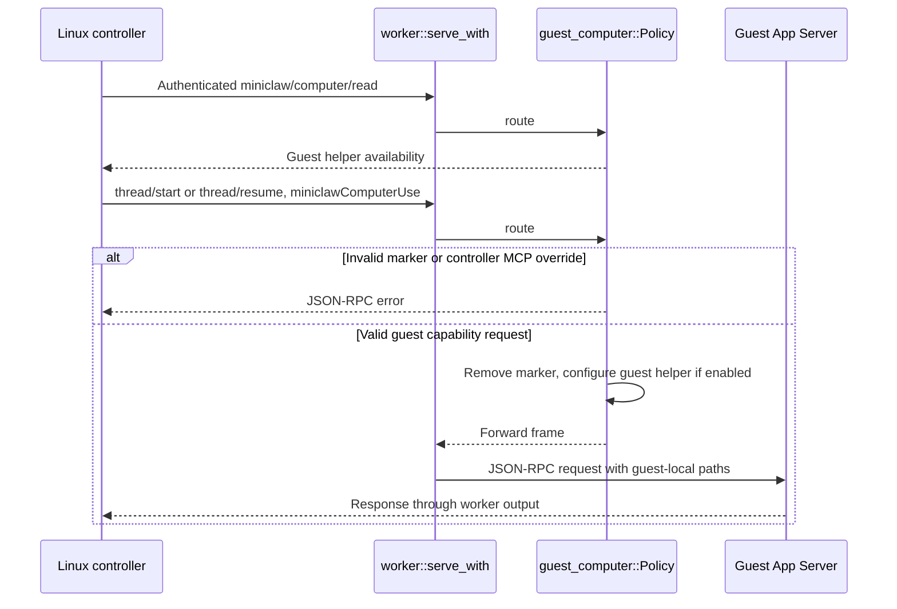

# Computer Use sequences

These diagrams trace the implementation described in the [capability page](README.md).
They separate configuration changes from approval of a later computer action.

## Existing-chat tool switch

This path assumes a loaded idle chat, a changed mode, unchanged authentication,
and no pending recovery. Early validation failures return before archive.

HTTP replies and SSE delivery travel independently; their arrival order at the
browser is not guaranteed. Both update only tool state through `applyComputer`.
Retry and restart recovery check archived location before deciding whether to
unarchive. Account-change and archive-error branches are detailed in
`set_computer`; they are omitted here to keep the normal switch readable.

## App approval during a turn

This path begins when Codex forwards a native-helper approval request. It does not
imply that every tool invocation requests a new approval.

The answer-channel delivery, RPC reply, and browser snapshot are asynchronous; the
diagram does not require the RPC reply to arrive before the browser update. If no
valid answer arrives, the RPC wait declines on timeout or channel closure. Stop
clears the pending approval and calls `turn/interrupt` independently of that wait.

## Guest configuration

The worker answers discovery locally. A missing helper rejects enable requests;
ordinary frames pass through unchanged. This diagram describes routing, not proof
of successful native screen capture or input.

## Source map

| Participant | Implementation |
| --- | --- |
| Svelte chat state | [chat.svelte.ts](../../web/src/chat.svelte.ts): `setComputer`, `applyComputer`, event subscription. |
| Svelte approval UI | [App.svelte](../../web/src/App.svelte) and [chat.svelte.ts](../../web/src/chat.svelte.ts): approval controls and `decide`. |
| API | [api.rs](../../server/src/api.rs): `set_computer`, `check_switch`, `resume_params`, `recover_tasks`, `decide`, `interrupt`. |
| Rust Chat cache | [chat.rs](../../server/src/chat.rs): `computer_changed`, `snapshot`, `emit`. |
| Recovery module | [recovery.rs](../../server/src/recovery.rs): `mark`, `clear`, `pending`. |
| Backend request listener | [chat.rs](../../server/src/chat.rs): `Backend::new`; form validation in [computer.rs](../../server/src/computer.rs): `Approval::new`. |
| RPC client | [rpc.rs](../../server/src/rpc.rs): `Client::spawn` reader and approval wait. |
| Guest routing | [guest_computer.rs](../../server/src/guest_computer.rs): `Policy::route`; [worker.rs](../../server/src/worker.rs): `serve_with`, `requests`, `send`. |
| Owned App Server | Launched by [runtime.rs](../../server/src/runtime.rs): `launch`. Its internal native-action execution is outside these diagrams. |
