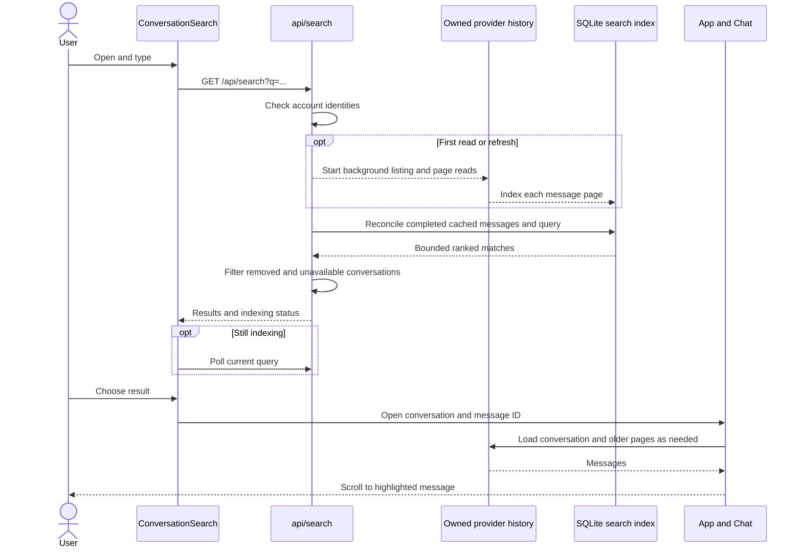

# Search sequence

- Page: [`ConversationSearch.svelte`](../../web/src/ConversationSearch.svelte), `read`, `choose`.
- API: [`api/search.rs`](../../server/src/api/search.rs), `search`, `build`, `index_thread`.
- History: [`api.rs`](../../server/src/api.rs), `tasks`, and [`history.rs`](../../server/src/history.rs), `page`.
- Index: [`search.rs`](../../server/src/search.rs), `Index::put`, `Index::query`.
- Chat: [`App.svelte`](../../web/src/App.svelte), `openSearch`, and
  [`chat.svelte.ts`](../../web/src/chat.svelte.ts), `select`, `loadOlder`.

[Conversation search](README.md)
