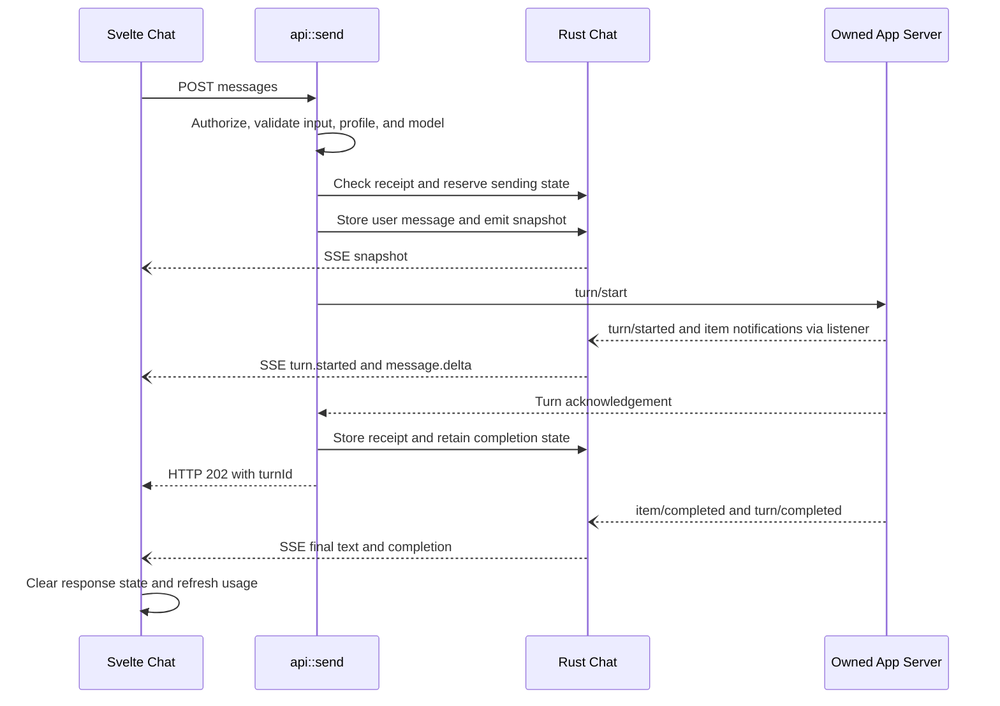
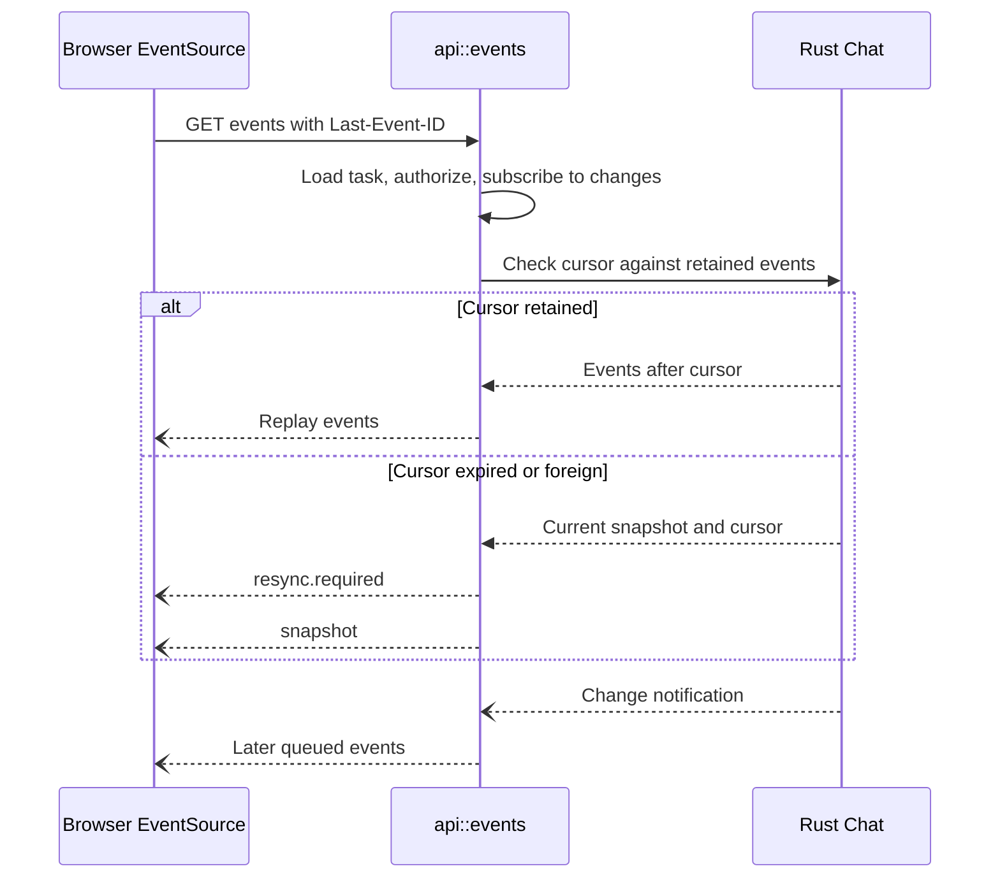
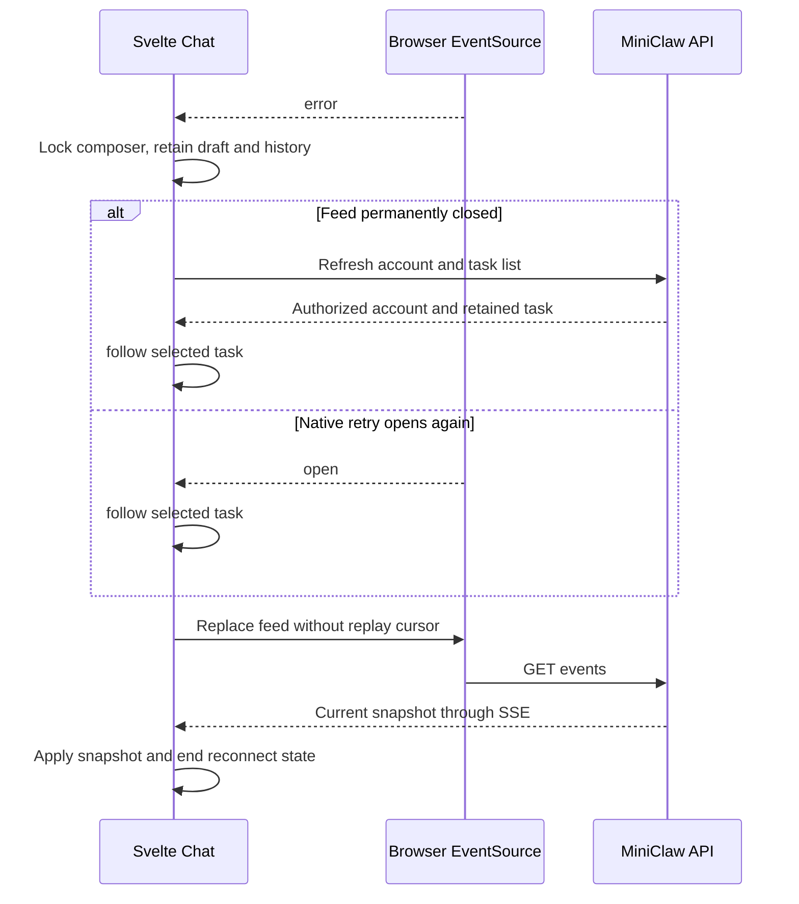

# Conversation sequences

[Conversation contracts](README.md)

## Send and completion

This path assumes an authorized, loaded idle chat and a new message ID. The SSE
connection already exists. HTTP acknowledgements and event delivery are independent.

Completion can also arrive before the acknowledgement. The backend finished-turn
list and frontend finished-turn set prevent that late reply from reopening a turn.

## Reconnect

A connection without a cursor begins with a snapshot. A stream closes on account
generation change or loss of the owned runtime.

## Browser recovery

Recovery does not send a message or navigate the page.

| Participant | Source |
| --- | --- |
| Svelte Chat / EventSource | [chat.svelte.ts](../../web/src/chat.svelte.ts): `send`, `select`, `follow`, `refresh`, `apply`, `append`, `stop`. |
| API | [api.rs](../../server/src/api.rs): `send`, `receipt`, `events`, `interrupt`. |
| Rust Chat | [chat.rs](../../server/src/chat.rs): `notify`, `emit`, `snapshot`, `Backend::new`. |
| Codex | [rpc.rs](../../server/src/rpc.rs): reply/notification routing. |
