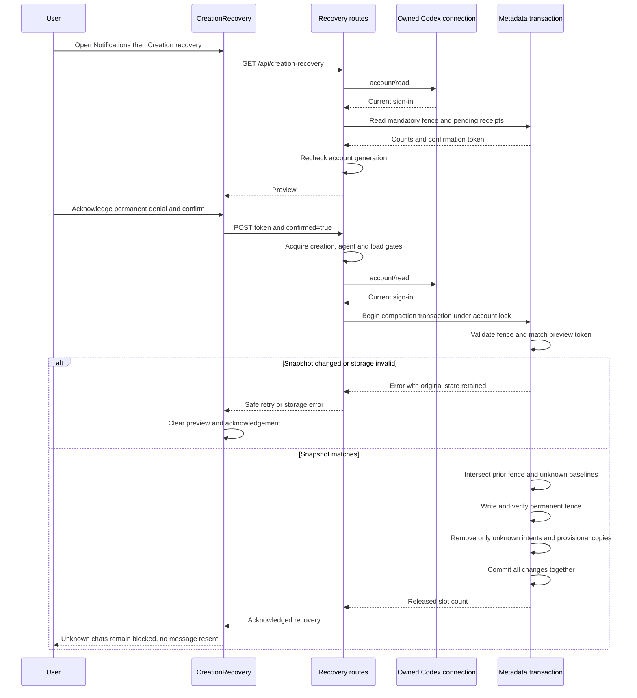

# Creation recovery sequence

[Capability](README.md)

[CreationRecovery.svelte](../../web/src/CreationRecovery.svelte) owns the preview,
checkbox and confirmation. [Notifications.svelte](../../web/src/Notifications.svelte)
provides its entry point. [api.rs](../../server/src/api.rs), `creation_recovery` and
`compact_creations`, handle authorization and gate order. The underlying
[quarantine module](../../server/src/agents/quarantine.rs), `read`, `preview`,
`Store::creation_recovery` and `Store::compact_creations`, owns state validation and
the transaction. [creation.rs](../../server/src/agents/creation.rs), `migrate` and
`Store::check_creation`, applies the mandatory schema and permanent fence to history.
