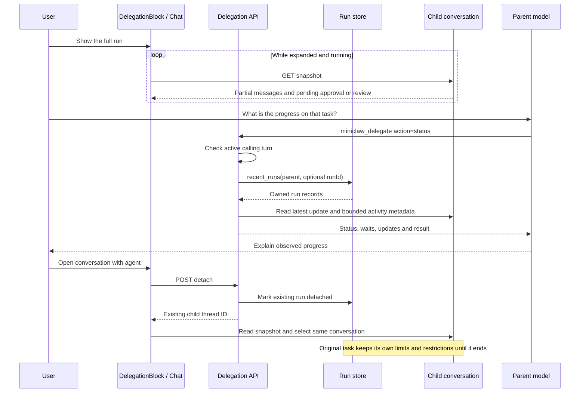
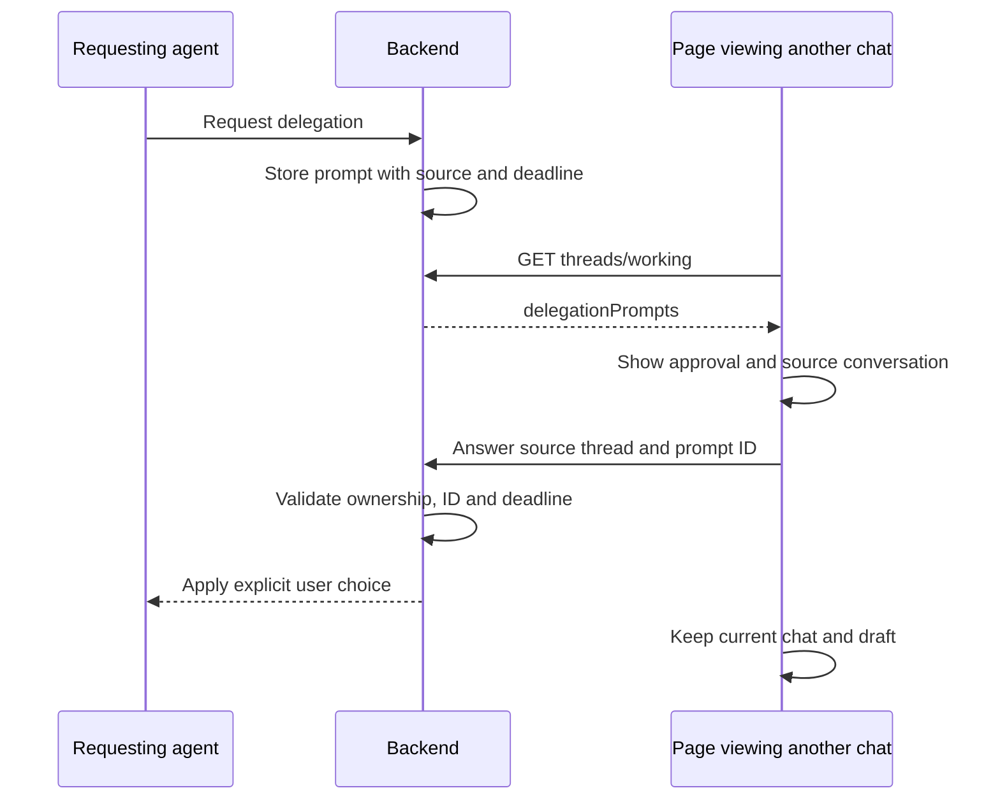

# Delegated progress and opening a run

[Delegation](README.md)



| Participant | Source |
| --- | --- |
| DelegationBlock / Chat | [DelegationBlock.svelte](../../web/src/DelegationBlock.svelte): refresh effect and `openConversation`; [chat.svelte.ts](../../web/src/chat.svelte.ts): `runTranscript`, `continueWithRun` |
| Delegation API | [api/delegation.rs](../../server/src/api/delegation.rs): `handle`, `status`, `detach`, `attempt` |
| Run store | [delegations.rs](../../server/src/delegations.rs): `recent_runs`, `detach_run`, `is_delegated` |
| Child conversation | [chat.rs](../../server/src/chat.rs): `snapshot`, `publish_activity`; activity metadata from [activity.rs](../../server/src/activity.rs): `list` |
| Parent model | Existing Codex dynamic-tool dispatch in [chat.rs](../../server/src/chat.rs); Claude bridge in [tool_bridge.rs](../../server/src/tool_bridge.rs) |

## Approval from another conversation



Sources: api.rs `working_tasks`, api/delegation.rs `answer`, chat.svelte.ts
`refreshWork` and `answerDelegation`. Diagram not visually rendered.


## Child requests in the parent

```mermaid
sequenceDiagram
    participant Child as Child conversation
    participant Loop as Delegation run loop
    participant UI as Parent Chat UI
    participant API as Existing decision routes
    Child->>Child: Hold permission, computer, review or question request
    Loop->>Child: Read live requests for this run
    Loop-->>UI: delegation.requests with run ID and child owner
    UI->>API: Read parent snapshot or working-tasks poll on return
    API-->>UI: Current delegatedRequests
    UI->>UI: Keep own prompts and each child's queue separate
    UI->>API: User answers at child thread request URL
    API->>Child: Validate active turn and deadline, deliver answer
    API-->>UI: Acknowledge decision
    UI->>UI: Remove this request, display next
    Loop-->>UI: Updated queue for this run
```

Source: [`pending_requests`, `attempt`, `describe`](../../server/src/api/delegation.rs),
[`working_tasks` and decision routes](../../server/src/api.rs),
[`Chat` pending getters and decision methods](../../web/src/chat.svelte.ts).
Diagram syntax inspected; no Mermaid renderer was run.
