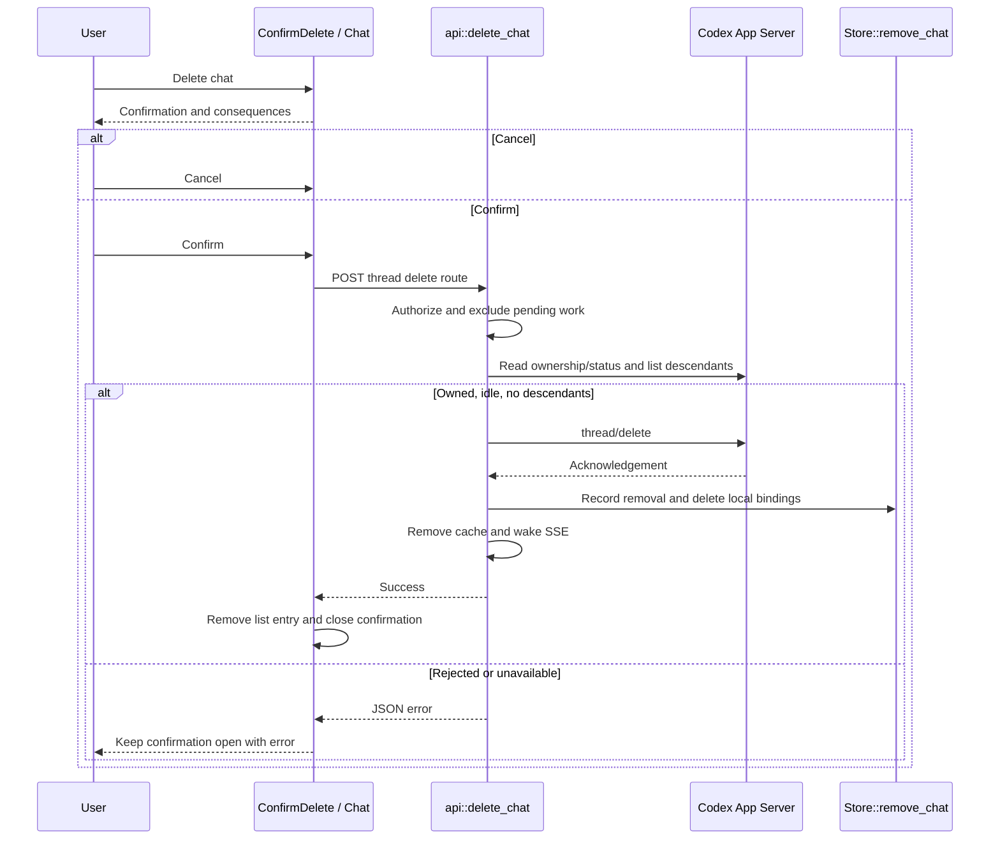

# Confirmed chat deletion

- [ConfirmDelete](../../web/src/ConfirmDelete.svelte) and [Chat.deleteChat](../../web/src/chat.svelte.ts): confirmation and guarded UI update.
- [api::delete_chat](../../server/src/api.rs): authorization, ownership, idle and descendant checks, Codex request.
- [Store::remove_chat](../../server/src/projects.rs): transactional local cleanup and removal marker.

[Deletion contracts](README.md)
