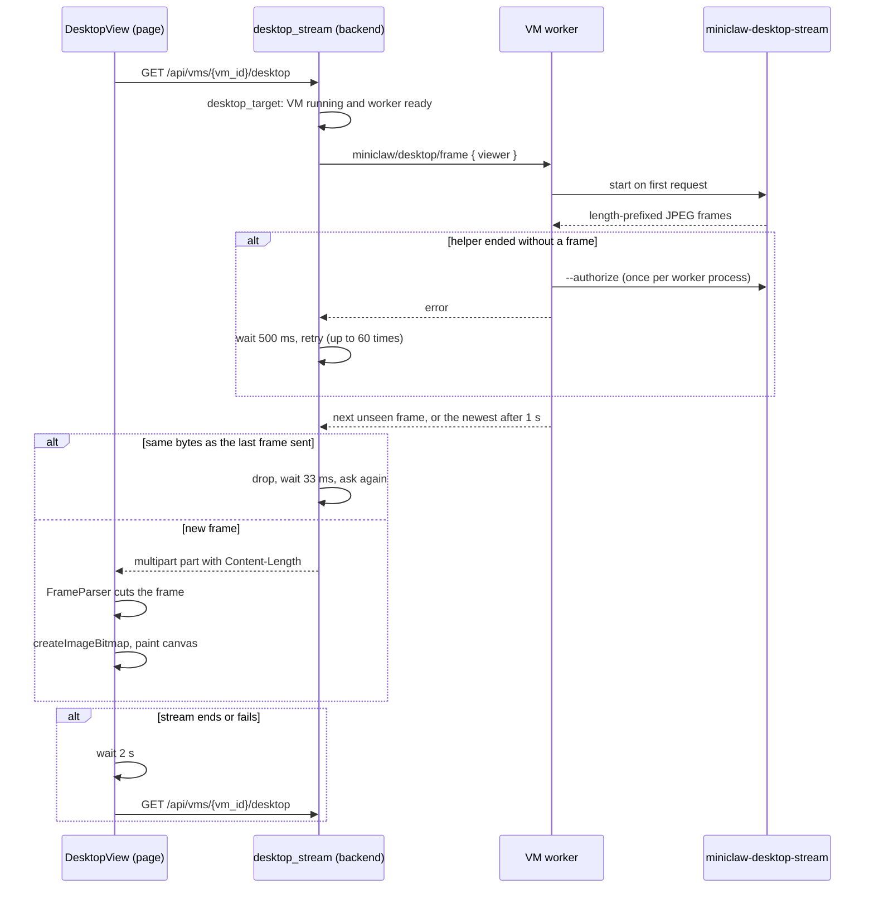

# VM desktop stream sequence

| Participant | Source |
| --- | --- |
| DesktopView | [DesktopView.svelte](../../web/src/DesktopView.svelte), [desktop-stream.ts](../../web/src/desktop-stream.ts) `readFrames`, `FrameParser` |
| desktop_stream | [api.rs](../../server/src/api.rs) `desktop_stream`, `desktop_target`, `desktop_frame`; [frames.rs](../../server/src/frames.rs) `part`, `Fresh` |
| VM worker | [worker.rs](../../server/src/worker.rs) `Viewers`, `next_frame`, `capture_desktop`, `request_capture_access` |
| Helper | [desktop-stream.swift](../../scripts/vm/desktop-stream.swift) |

Back to [VM desktop stream](README.md).
