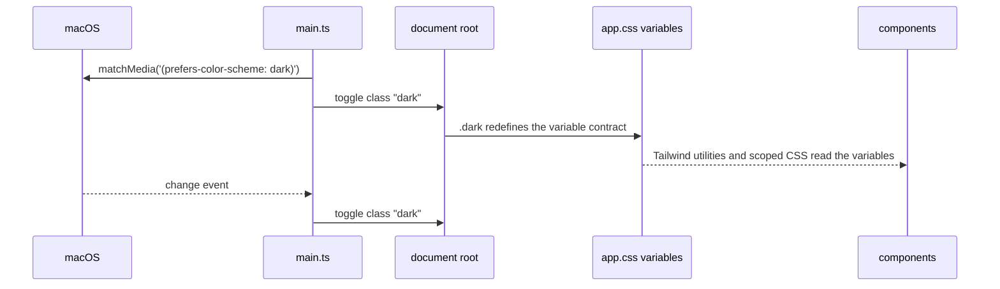
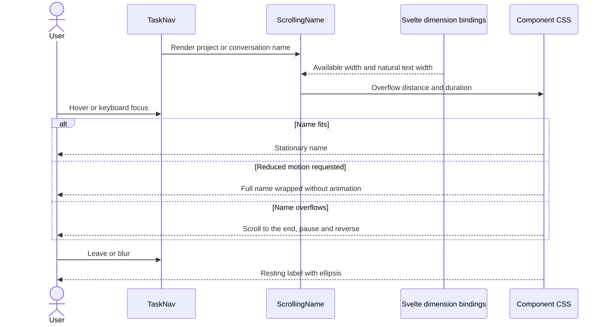

# Appearance sequence

| Participant | Source |
| --- | --- |
| main.ts | [main.ts](../../web/src/main.ts) `applyAppearance` |
| app.css variables | [app.css](../../web/src/app.css) `:root`, `.dark`, `@theme inline` |
| components | [web/src/lib/components/ui](../../web/src/lib/components/ui), feature components in [web/src](../../web/src) |

Back to [Frontend components and theme](README.md).

## Sidebar names

[TaskNav.svelte](../../web/src/TaskNav.svelte) supplies the names and buttons.
[ScrollingName.svelte](../../web/src/ScrollingName.svelte) owns the size bindings,
overflow calculation and scoped CSS. Svelte updates the bindings when the label or
its container changes size.
