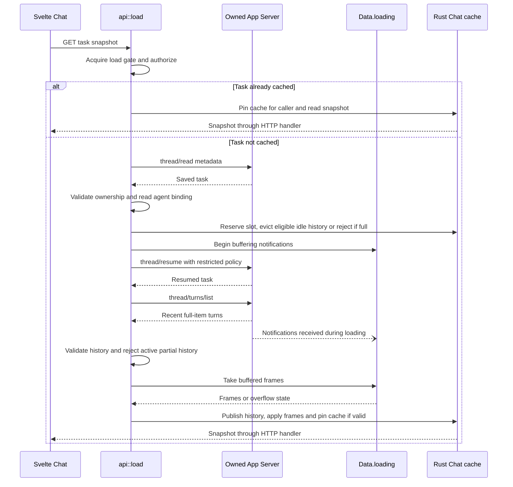
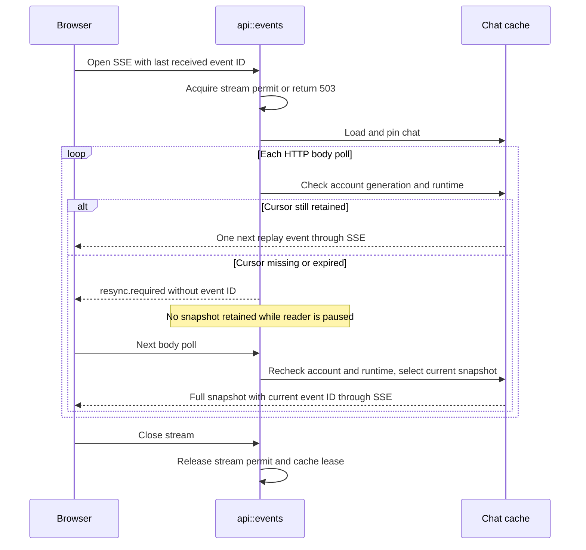
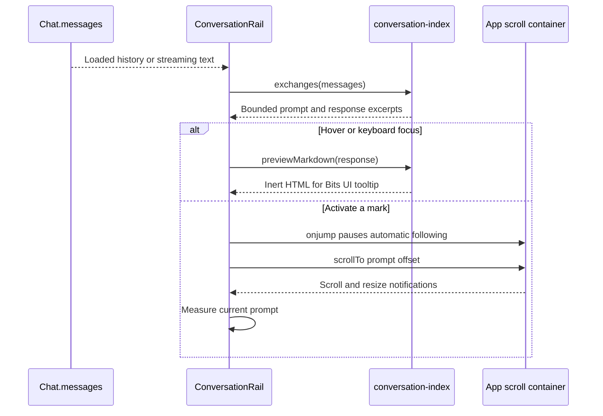

# Restore a saved task

[History contracts](README.md)

Buffering begins before resume and continues until publication. Its arrow shows
possible notification delivery, not a required event after the history response.
Any validation failure removes the loading entry without publishing a usable chat.

| Participant | Source |
| --- | --- |
| Svelte Chat | [chat.svelte.ts](../../web/src/chat.svelte.ts): `select`, `loadOlder`. |
| Loader | [api.rs](../../server/src/api.rs): `load`, `snapshot`, `activate`, `older`. |
| History reads | [history.rs](../../server/src/history.rs): `summary`, `page`. |
| Buffer | [history.rs](../../server/src/history.rs): `Loading::push`; [chat.rs](../../server/src/chat.rs): notification listener. |
| Chat cache | [chat.rs](../../server/src/chat.rs): `Data::make_room`, `Chat::pin`, `notify`, `snapshot`. |

## Replay after a slow reader

Sources: [api::events](../../server/src/api.rs) owns stream admission and polling;
[Chat::emit](../../server/src/chat.rs) bounds replay payload. Account or runtime
loss closes the stream before its next event. A fresh connection without a cursor
starts with the current snapshot. Neither resynchronization nor closing a stream
resends a message.

## Navigate loaded exchanges

Sources: [ConversationRail](../../web/src/ConversationRail.svelte),
[preview grouping and rendering](../../web/src/conversation-index.ts),
[App](../../web/src/App.svelte). Navigation does not call the backend.
