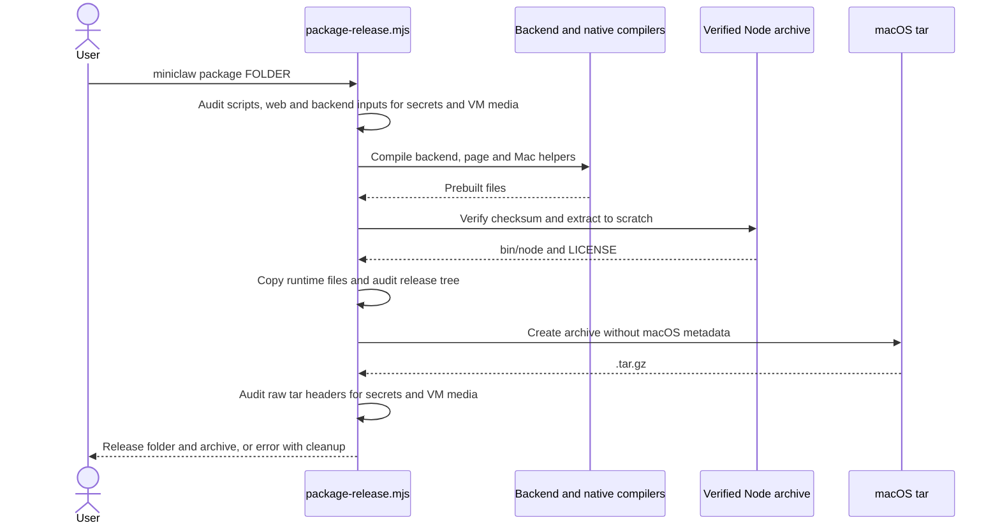
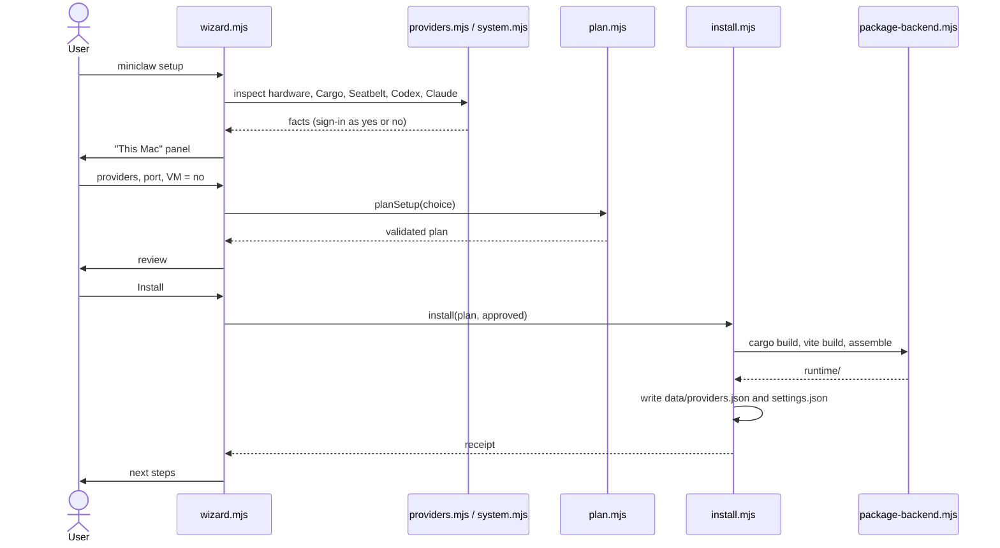
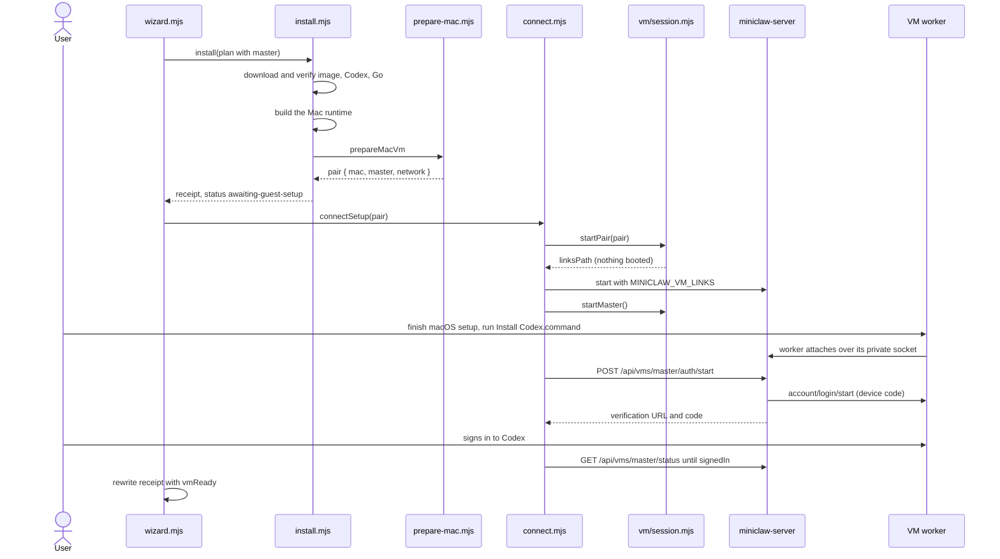
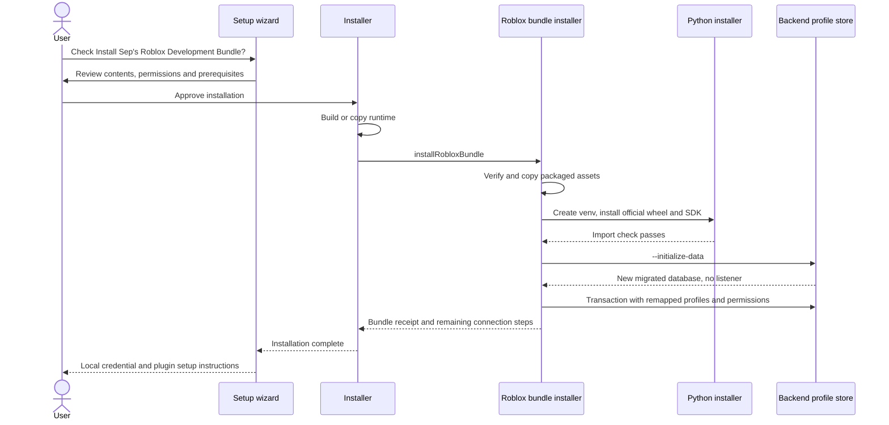

# Installation sequence

Back to [installation](README.md).

## Release packaging

Package: [`package-release.mjs`](../../scripts/package-release.mjs) `main`,
`auditReleaseTree`, `extractNodeRuntime` and `auditReleaseArchive`.
The sequence was checked against the source; no Mermaid renderer is installed locally.

## Mac-only install

## Install with the optional VM

## Optional Roblox bundle

Wizard: [`questions.mjs`](../../scripts/setup/questions.mjs) `collectChoices` and
[`wizard.mjs`](../../scripts/setup/wizard.mjs); installer:
[`install.mjs`](../../scripts/setup/install.mjs) `install`; bundle:
[`roblox-bundle.mjs`](../../scripts/setup/roblox-bundle.mjs) `installRobloxBundle`,
`prepareDependencies`, `seedDatabase`; backend:
[`main.rs`](../../server/src/main.rs) initialization mode and `Store::open` migrations.
This added diagram was checked against the call sequence but has not been rendered.
