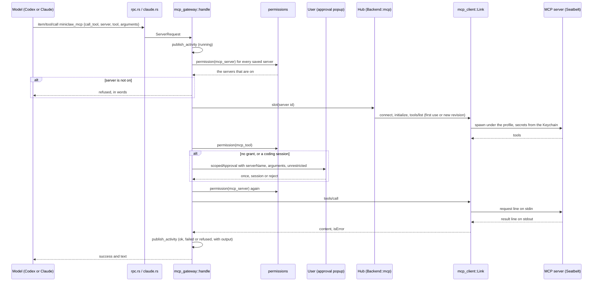

# MCP servers: sequence

Back to [MCP servers](README.md).

One `call_tool` from a model to a sandboxed local server.

| Participant | Source |
|---|---|
| rpc.rs / claude.rs | [`rpc.rs`](../../server/src/rpc.rs) tool call filter; [`claude.rs`](../../server/src/claude.rs) `tool_call`; [`tool_bridge.rs`](../../server/src/tool_bridge.rs) `tools` |
| mcp_gateway | [`mcp_gateway.rs`](../../server/src/mcp_gateway.rs) `handle`, `run`, `list`, `call`, `ask`, `switched_on` |
| permissions | [`permissions.rs`](../../server/src/permissions.rs) `Target::McpServer`, `Target::McpTool`, `forget_mcp_server` |
| Hub | [`mcp_gateway.rs`](../../server/src/mcp_gateway.rs) `Hub`, `ensure` |
| Link | [`mcp_client.rs`](../../server/src/mcp_client.rs) `Link::connect`, `tools`, `call`, `spawn`, `http` |
| Approval popup | [`App.svelte`](../../web/src/App.svelte), the `mcp_tool` branch of the scoped approval dialog |

The diagram's syntax was not checked with a renderer.
