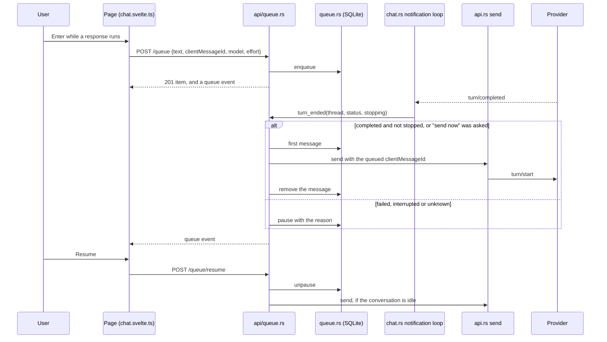

# Message queue: sequence

Back to [Message queue](README.md).

| Participant | Source |
|---|---|
| Page | [`chat.svelte.ts`](../../web/src/chat.svelte.ts) `enqueue`, `queueAction`, `takeQueue`, `queueable`; [`MessageQueue.svelte`](../../web/src/MessageQueue.svelte) |
| api/queue.rs | [`api/queue.rs`](../../server/src/api/queue.rs) `add`, `install`, `drain`, `resume`, `send_now`, `publish` |
| queue.rs | [`queue.rs`](../../server/src/queue.rs) `enqueue`, `pause_queue`, `queue_first`, `pause_queues_after_restart` |
| notification loop | [`chat.rs`](../../server/src/chat.rs) `listen_client`, `Backend::turn_ended` |

The diagram's syntax was not checked with a renderer.
