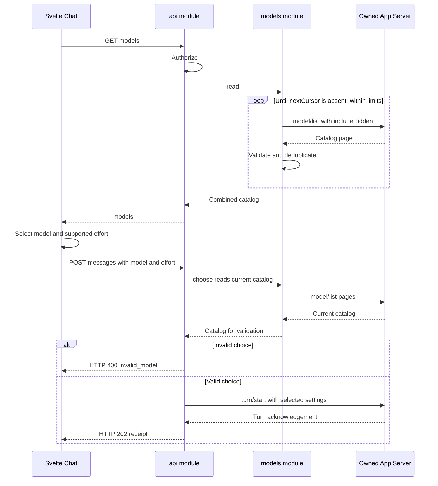
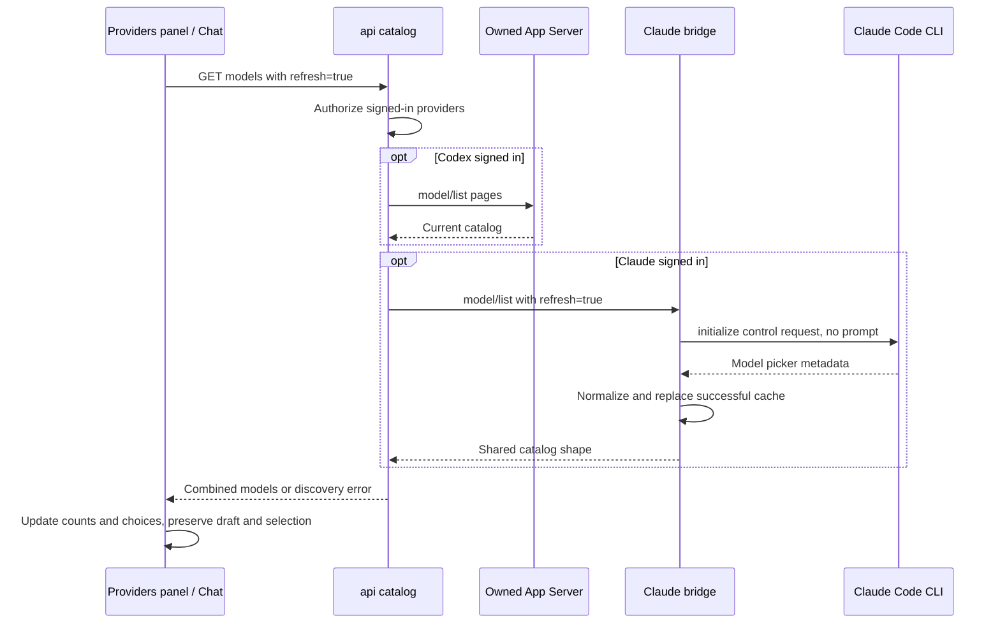

# Model discovery and selection

[Model contracts](README.md)

The Codex send path shown assumes a loaded idle chat and a new message ID. An identical
already-acknowledged receipt returns before catalog discovery.

| Participant | Source |
| --- | --- |
| Svelte Chat | [chat.svelte.ts](../../web/src/chat.svelte.ts): `refreshModels`, `setModel`, `setEffort`, `send`. |
| API | [api.rs](../../server/src/api.rs): `catalog`, `read_models`, `choose`, `send`. |
| Models | [models.rs](../../server/src/models.rs): `read`, `pages`. |
| Codex | Requests pass through [rpc.rs](../../server/src/rpc.rs): `Client::call`. |

## Provider refresh

`Providers.svelte` calls `Chat.refresh(true)` through its existing header control.
[api.rs](../../server/src/api.rs) owns `CatalogQuery` and `catalog`.
[models.rs](../../server/src/models.rs) owns `refresh_claude` and pagination.
[claude.rs](../../server/src/claude.rs) owns `Bridge::models`, `control`, and normalization
in `catalog`. A failed discovery leaves the previous cache intact and returns an error;
the page retains its prior list and reports the failure.
