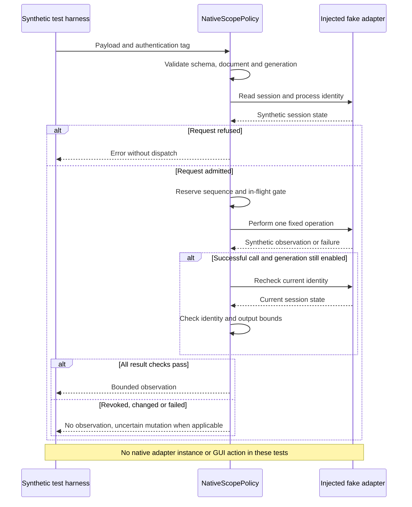

# Native scope probe sequence

`Harness` and `Adapter` are in
[support/native-scope.swift](../../tests/experiments/support/native-scope.swift).
`Policy` is in
[native-scope-policy.swift](../../scripts/experiments/native-scope-policy.swift).
The native adapter is compiled alongside this harness without being instantiated.

[Capability](README.md)
