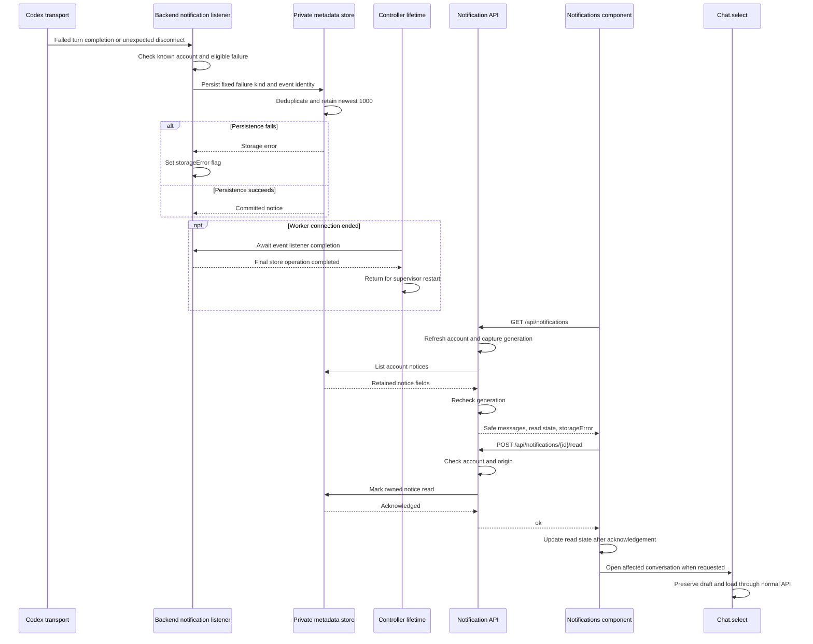
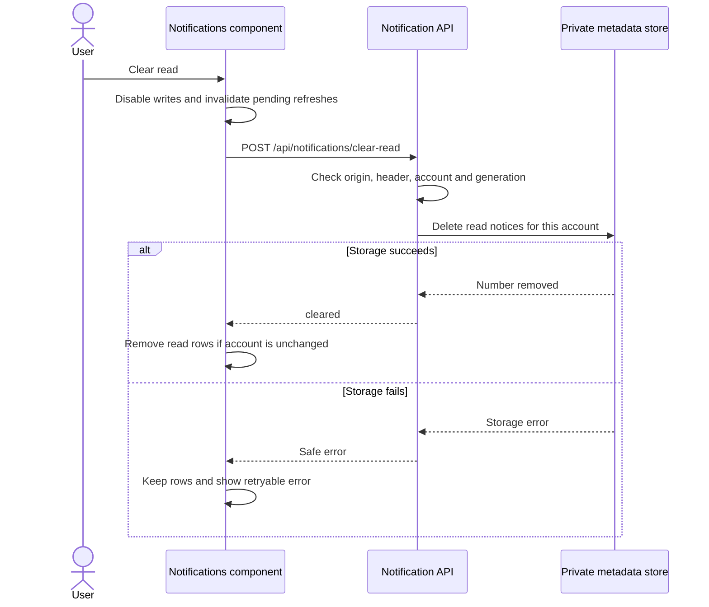

# Notification sequence

[Capability](README.md)

The transport and intentional-stop marker are in
[rpc.rs](../../server/src/rpc.rs), `Client::transport` and `Client::stop`.
The listener is in [chat.rs](../../server/src/chat.rs), `Backend::new`.
Persistence and fixed messages are in [notifications.rs](../../server/src/notifications.rs),
`Store::response_failure`, `Store::runtime_failure`, `Store::record_notice` and
`Store::notices`. The routes and generation checks are in
[api.rs](../../server/src/api.rs), `notifications` and `read_notification`.
The interface is [Notifications.svelte](../../web/src/Notifications.svelte);
[App.svelte](../../web/src/App.svelte) connects its conversation action to
[`Chat.select`](../../web/src/chat.svelte.ts).

[main](../../server/src/main.rs) stops every client during shutdown and awaits
`Client::drain_events` for each before returning. `Client::stop` and `Client::closed` continue to wait
only for transport cleanup, keeping the listener independent of its own drain.

The alternate [remote controller guard](../../server/src/remote.rs) also drains after
transport closure. [Main](../../server/src/main.rs) drains during local graceful
shutdown. `Completion` observes the raw transport watch without owning a `Client`.

## Clearing read notices

The button and account guard are in
[Notifications.svelte](../../web/src/Notifications.svelte), `clearRead`.
The route is [api.rs](../../server/src/api.rs), `clear_read_notifications`;
the delete is [notifications.rs](../../server/src/notifications.rs),
`Store::clear_read_notices`.
