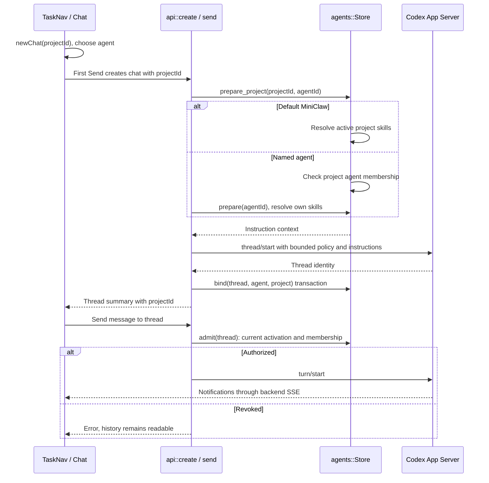

# Project chat

- [TaskNav](../../web/src/TaskNav.svelte) and [Chat](../../web/src/chat.svelte.ts): selection, creation, send, SSE.
- [api.rs](../../server/src/api.rs): `create`, `send`, `configure_context`, `tag_context`.
- [projects.rs](../../server/src/projects.rs): `prepare_project`, `project_context`, `admit`.
- [agents.rs](../../server/src/agents.rs): `prepare`, `bind`.

[Project contracts](README.md)
