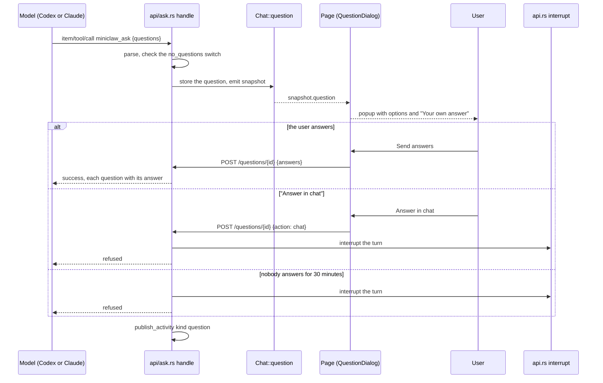

# Questions from the model: sequence

Back to [Questions from the model](README.md).

| Participant | Source |
|---|---|
| handle | [`api/ask.rs`](../../server/src/api/ask.rs) `install`, `handle`, `answer`, `switched_off` |
| Chat::question | [`chat.rs`](../../server/src/chat.rs) `PendingQuestion`, `QuestionReply`, the `turn/completed` branch that drops it |
| Page | [`QuestionDialog.svelte`](../../web/src/QuestionDialog.svelte), [`chat.svelte.ts`](../../web/src/chat.svelte.ts) `answerQuestion` |
| Tool and checks | [`ask.rs`](../../server/src/ask.rs) `tool_definition`, `parse`, `answers_fit`, `result_text` |

The diagram's syntax was not checked with a renderer.
