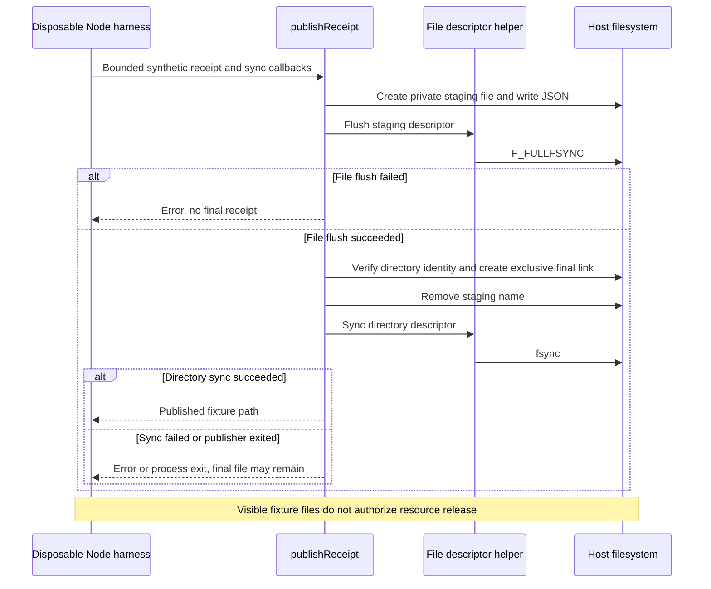

# Recovery evidence probe sequence

`Test` is [recovery-proof.test.mjs](../../tests/experiments/recovery-proof.test.mjs).
`Publisher` is [publishReceipt](../../scripts/experiments/recovery-proof.mjs).
`Helper` is [file-evidence.c](../../scripts/experiments/file-evidence.c), invoked
through explicitly supplied test callbacks. The pure classifier is called
separately with synthetic evidence; it never calls the publisher or filesystem.

[Capability](README.md)
