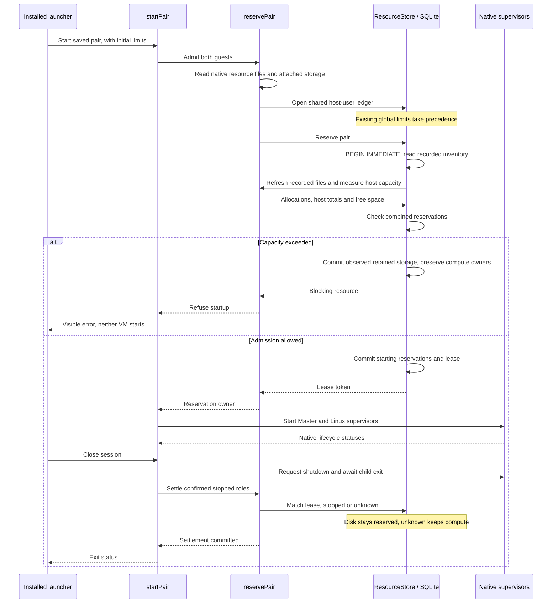

# Resource admission sequence

The installed launcher is [`start-host.mjs`](../../scripts/start-host.mjs).
[`startPair`](../../scripts/vm/session.mjs) owns process startup and shutdown.
[`reservePair`](../../scripts/vm/resource-admission.mjs) collects host input and
maps confirmed roles back to guest identities.
[`ResourceStore.reserve` and `settle`](../../scripts/vm/resource-store.mjs) own
durable admission and completion. A configuration or database error can also stop
the sequence before native startup.

See [host resource admission](README.md) for the inventory boundary and tests.
