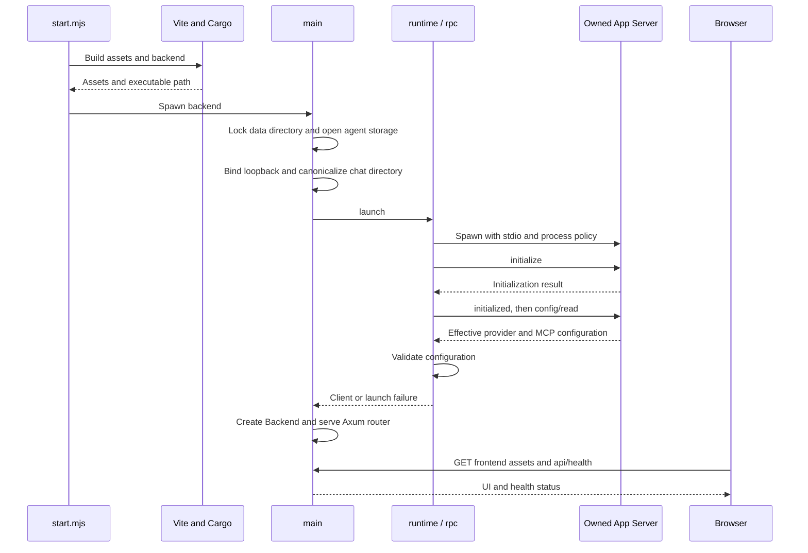
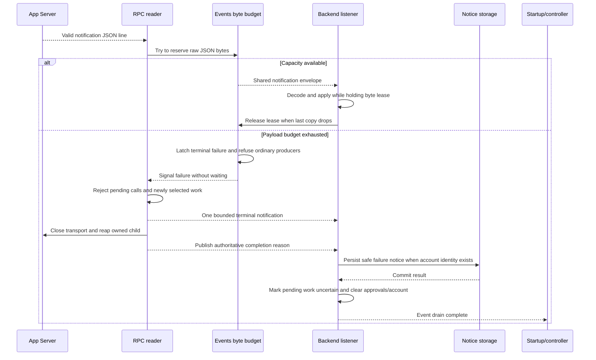

# Startup sequence

[Runtime and configuration](README.md)

If inherited MCP entries remain enabled, `runtime::launch` stops the first process
and retries once with those entries disabled. Invalid provider settings return a
launch failure. Storage or bind errors stop startup before serving HTTP.

| Participant | Source |
| --- | --- |
| Launcher/build | [start.mjs](../../scripts/start.mjs): `start`, `run`, `stop`. |
| Rust startup | [main.rs](../../server/src/main.rs): `main`, `instance`. |
| Runtime/RPC | [runtime.rs](../../server/src/runtime.rs): `launch`, `official`; [rpc.rs](../../server/src/rpc.rs): `Client::spawn`. |
| Browser | [Connection.svelte](../../web/src/Connection.svelte): `check`; [api.rs](../../server/src/api.rs): `router`, `health`. |

## Notification capacity and failure

The listener may process the terminal notification before child cleanup completes.
The completion watch supplies the same reason if normal broadcast delivery was lost
or the listener subscribed after termination. Neither route resends a message.
Generated approval-resolution events pass through the same byte admission.

Sources: [rpc.rs](../../server/src/rpc.rs) `Events::publish`, `finish`,
`Client::transport`, `Completion::closed`; [chat.rs](../../server/src/chat.rs)
`Backend::new`; [main.rs](../../server/src/main.rs) `main`;
[remote.rs](../../server/src/remote.rs) `guard`;
[notifications](../notifications/README.md) for durable safe notices.
