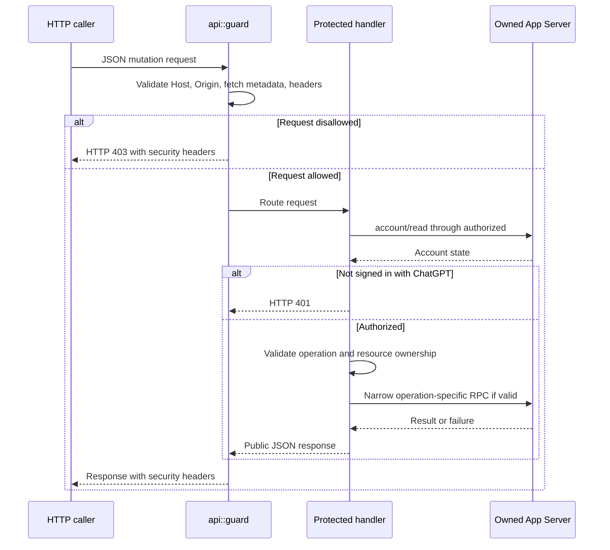

# Protected mutation

[Security boundary](README.md)

This diagram shows the common authorization boundary, not a required ordering for
every handler's input parsing. Invalid bodies or identifiers can fail before an
account read. Agent management writes SQLite instead of issuing a chat operation.

| Participant | Source |
| --- | --- |
| Guard | [api.rs](../../server/src/api.rs): `guard`, `router`, `Error::into_response`. |
| Protected handlers | [api.rs](../../server/src/api.rs): `authorized`, `send`, `create`, `save_agent`, `load`. |
| Codex transport | [rpc.rs](../../server/src/rpc.rs): `Client::call`, `refusal`; [runtime.rs](../../server/src/runtime.rs): `launch`. |
