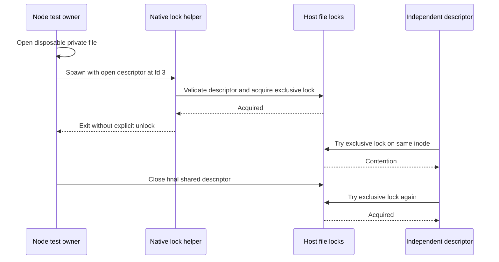

# Session ownership probe sequence

`Test` and `Contender` are the `acquire` and `contend` helpers in
[session-lock.test.mjs](../../tests/experiments/session-lock.test.mjs). `Helper`
is `main` in [session-lock.c](../../scripts/experiments/session-lock.c).
The test waits for the native helper's exit before checking contention.

[Capability](README.md)
