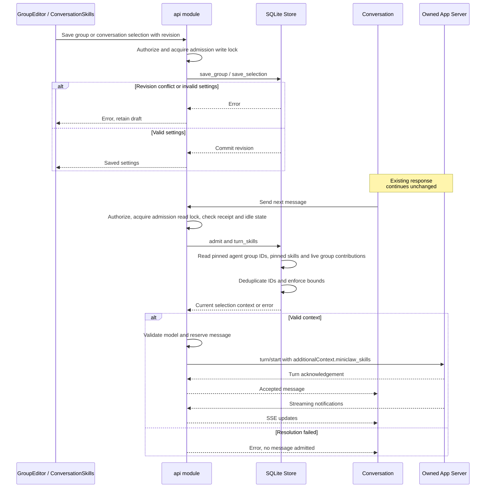

# Group changes and the next message

| Participant | Source |
| --- | --- |
| GroupEditor / ConversationSkills | [GroupEditor.svelte](../../web/src/GroupEditor.svelte): `save`; [ConversationSkills.svelte](../../web/src/ConversationSkills.svelte): `save`; [skill-groups.svelte.ts](../../web/src/skill-groups.svelte.ts): API state |
| API | [api.rs](../../server/src/api.rs): `save_group`, `save_chat_skills`, `send` |
| Store | [skill_groups.rs](../../server/src/skill_groups.rs): `save_group`, `save_selection`, `turn_skills`; [projects.rs](../../server/src/projects.rs): `admit` |
| Conversation | [chat.svelte.ts](../../web/src/chat.svelte.ts): `send`, `select` |
| Owned App Server | [rpc.rs](../../server/src/rpc.rs): request transport; [chat.rs](../../server/src/chat.rs): notifications |

Notifications may precede the turn acknowledgement. Existing receipt and SSE
handling retain that ordering independently of group resolution.

[Capability documentation](README.md)
