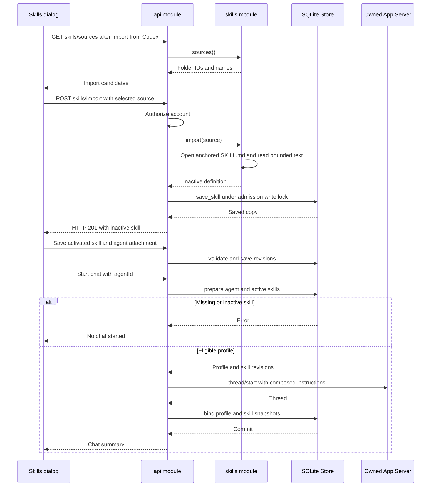

# Skill import and chat binding

The import copy is created before activation or attachment. These are separate user
actions, not automatic consequences of import. Codex thread creation and SQLite
binding are separate commits. See [agent recovery constraints](../agents/sequence.md).

## Source map

| Participant | Implementation |
| --- | --- |
| Skills dialog | [Skills.svelte](../../web/src/Skills.svelte): `discover`, `importSkill`, `save`; [Agents.svelte](../../web/src/Agents.svelte): attachment form. |
| API | [api.rs](../../server/src/api.rs): `skill_sources`, `import_skill`, `save_skill`, `save_agent`, `create`. |
| Source | [skills.rs](../../server/src/skills.rs): `sources`, `source_file`, `import`. |
| Store | [skills.rs](../../server/src/skills.rs): `save_skill`, `resolve`; [agents.rs](../../server/src/agents.rs): `prepare`, `configure`, `bind`, `binding`. |
| Owned App Server | [rpc.rs](../../server/src/rpc.rs): request transport. |

[Capability documentation](README.md)
