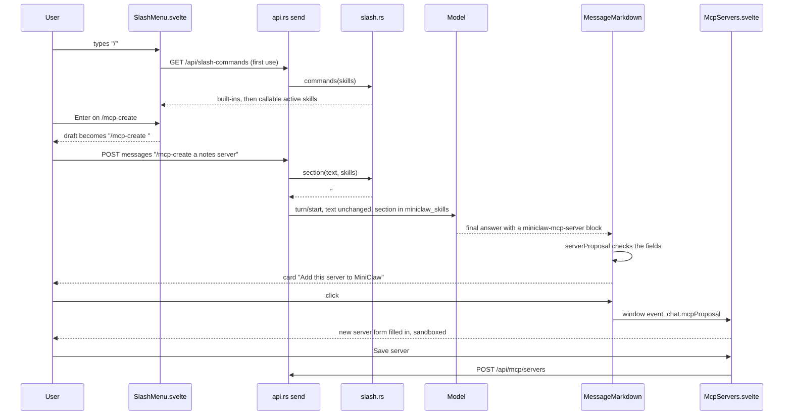

# Slash commands: sequence

Back to [Slash commands and /mcp-create](README.md).

| Participant | Source |
|---|---|
| SlashMenu | [`SlashMenu.svelte`](../../web/src/SlashMenu.svelte) `key`, `choose` |
| send | [`api.rs`](../../server/src/api.rs) `send`, `slash_commands` |
| slash.rs | [`slash.rs`](../../server/src/slash.rs) `commands`, `section`, `named`, `slug` |
| MessageMarkdown | [`message-markdown.ts`](../../web/src/message-markdown.ts) `serverProposal`, `card`; [`MessageMarkdown.svelte`](../../web/src/MessageMarkdown.svelte) `act` |
| McpServers | [`McpServers.svelte`](../../web/src/McpServers.svelte), the `chat.mcpProposal` effect |

The diagram's syntax was not checked with a renderer.
