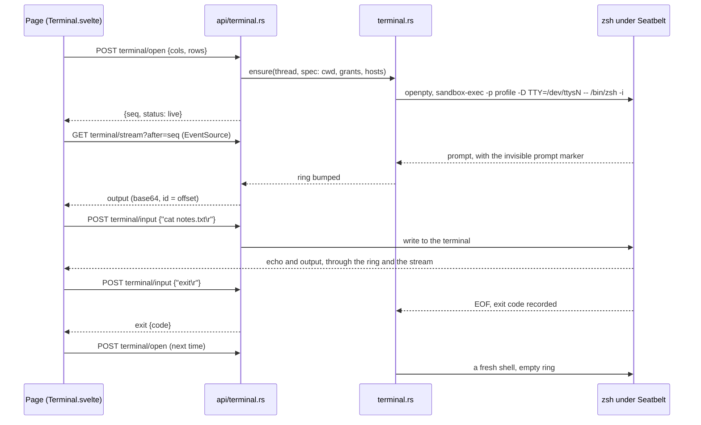

# Terminal: sequence

Back to [Terminal](README.md).



## An agent command

```mermaid
sequenceDiagram
    participant M as Model
    participant C as chat.rs scoped_tool_result
    participant U as User (popup)
    participant T as terminal.rs run
    participant Z as zsh
    participant P as Page

    M->>C: run_shell {text, cwd, hosts}
    C->>U: approval popup (as before)
    U-->>C: approve
    C->>T: run(call, text, cwd, hosts)
    T->>T: wait for the prompt marker
    T->>Z: write run/<call>.zsh, type Ctrl-U __mc <call>
    Z-->>P: dimmed command line, then output (via the ring)
    Z-->>T: start marker ... output ... end marker;code
    T-->>C: Ran {output <= 60 KiB, code, refused}
    C-->>M: Exit code, stdout (one-shot shape)
    C-->>P: Activity entry finished
    Note over T,C: past 120 s: partial result now, Activity finished later
```
