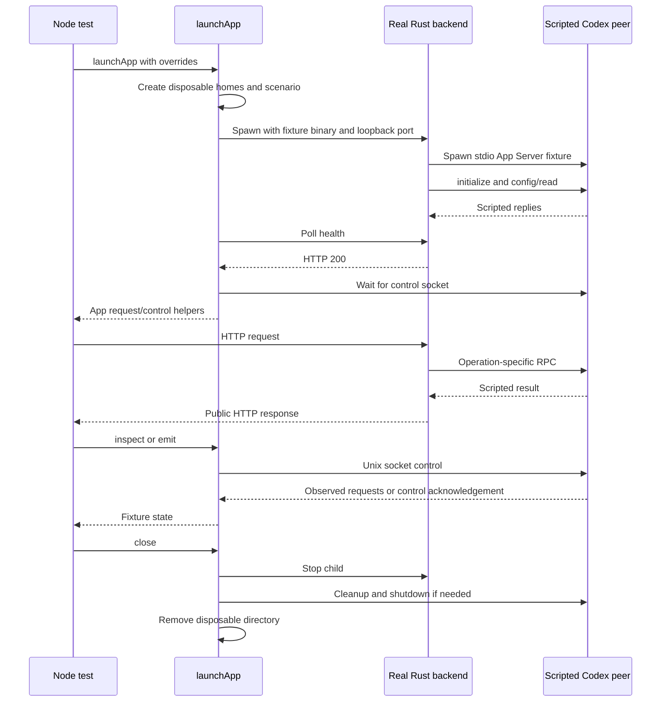

# API fixture lifecycle

[Test architecture](README.md)

Tests can emit notifications before acknowledgements or hold replies to exercise
races. This diagram shows a simple successful request, not every scripted ordering.

| Participant | Source |
| --- | --- |
| Tests | [tests](../../tests): API and contract suites. |
| Harness | [harness.mjs](../../tests/support/harness.mjs): `peerFixture`, `launchApp`, `stopChild`, `control`. |
| Rust backend | [main.rs](../../server/src/main.rs), [rpc.rs](../../server/src/rpc.rs), [api.rs](../../server/src/api.rs). |
| Scripted peer | [fake-codex.mjs](../../tests/support/fake-codex.mjs), [fixtures.mjs](../../tests/support/fixtures.mjs). |
