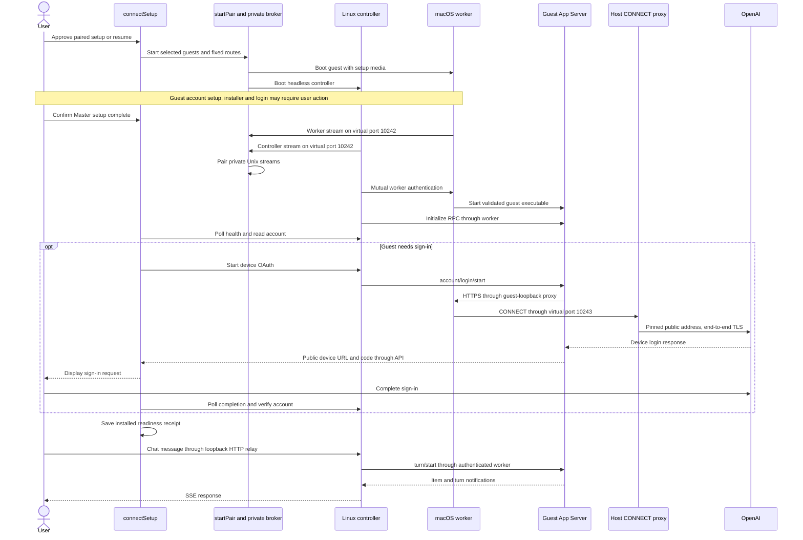
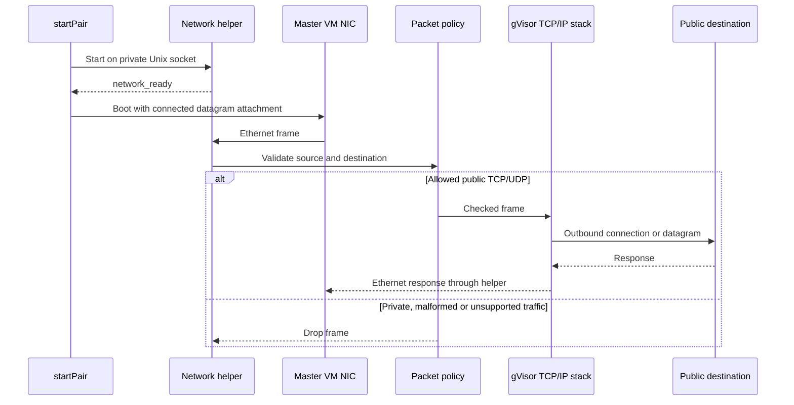
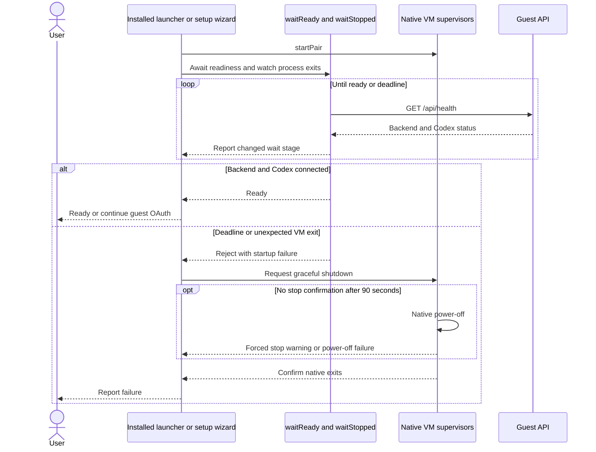

# VM connection sequence

Sources: [connectSetup](../../scripts/setup/connect.mjs),
[signIn](../../scripts/setup/auth.mjs), [finishGuest](../../scripts/setup/wizard.mjs),
[startPair](../../scripts/vm/session.mjs), [startBroker](../../scripts/vm/broker.mjs),
[controller startup](../../server/src/main.rs),
[worker](../../server/src/bin/miniclaw-worker.rs),
[egress](../../scripts/vm/egress.mjs).

[VM connection](README.md)

## Master networking

Sources: [startPair](../../scripts/vm/session.mjs),
[attachment](../../scripts/vm/guest-network.swift),
[helper](../../scripts/vm/network-helper/network.go),
[policy](../../scripts/vm/network-helper/policy.go).

## Readiness and failure

Sources: [readiness.mjs](../../scripts/vm/readiness.mjs),
[installed launcher](../../scripts/start-host.mjs),
[connectSetup](../../scripts/setup/connect.mjs).
