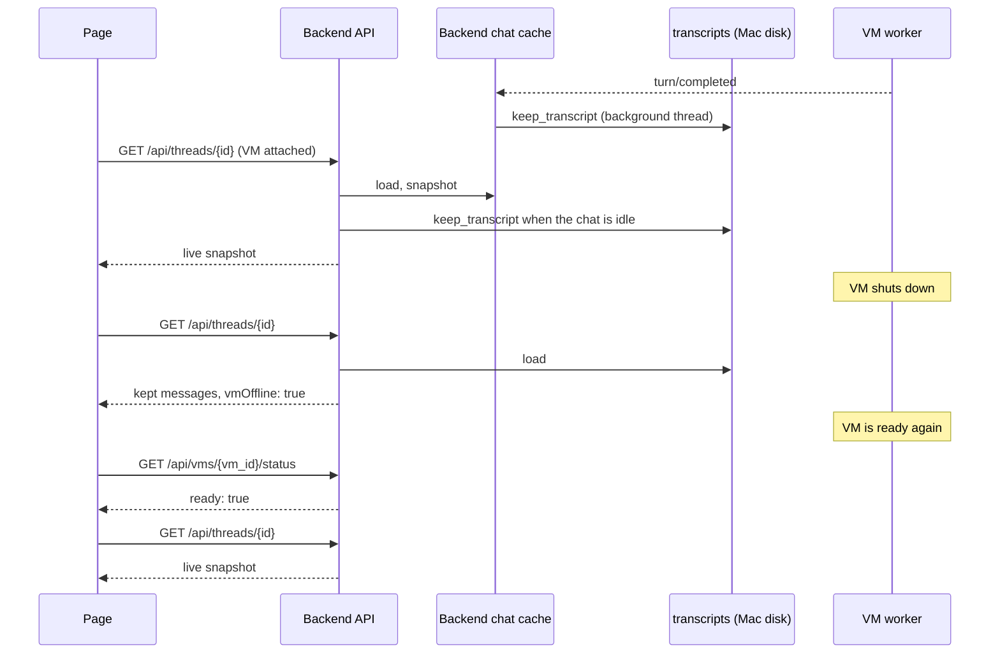

# VM chat history sequence

| Participant | Source |
| --- | --- |
| Page | [chat.svelte.ts](../../web/src/chat.svelte.ts) `refreshVmStatus`, `select` |
| Backend API | [api.rs](../../server/src/api.rs) `snapshot`, `delete_chat` |
| Backend chat cache | [chat.rs](../../server/src/chat.rs) `keep_transcript`, `listen_client` |
| transcripts | [transcripts.rs](../../server/src/transcripts.rs) `save`, `load`, `remove` |

Back to [VM chat history on the Mac](README.md).
