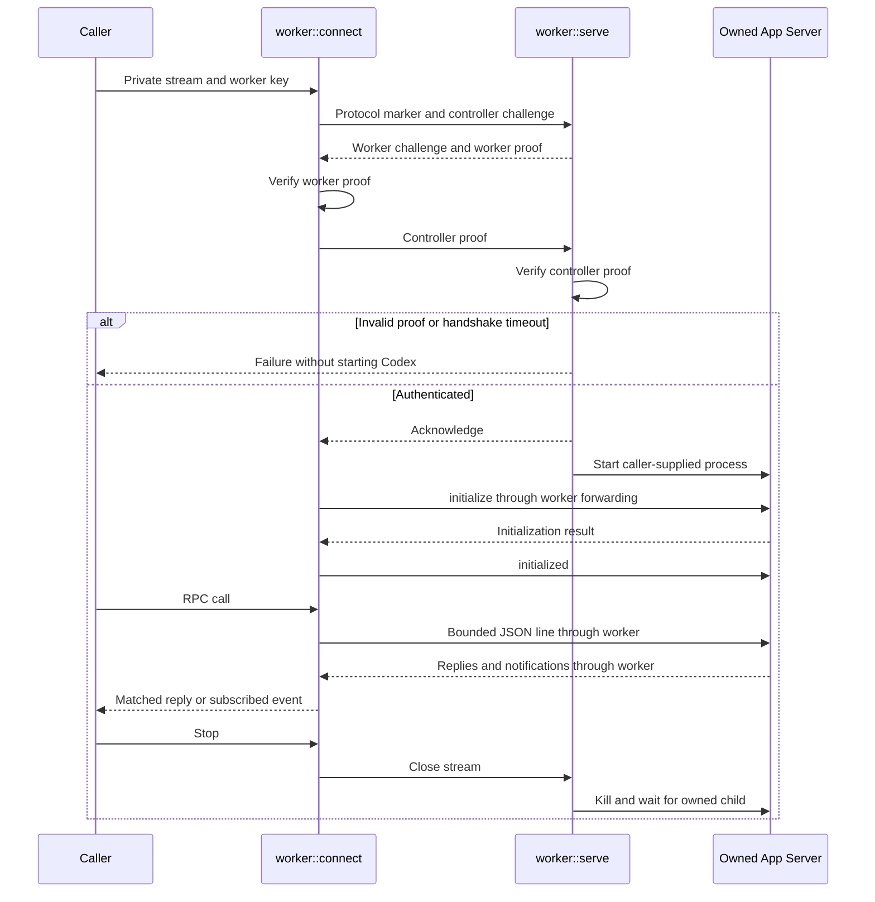
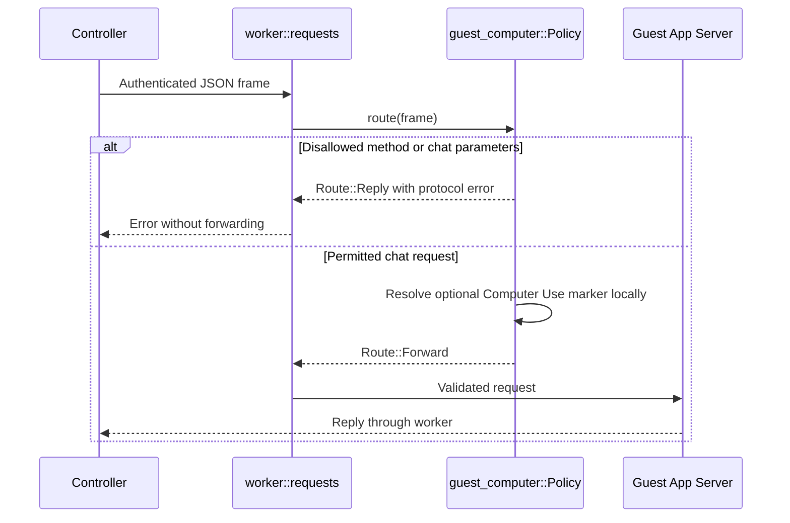

# Worker transport sequence

Sources: [connect, serve, exchange and forward](../../server/src/worker.rs),
[Client::attach, transport and stop](../../server/src/rpc.rs).

## Installed guest policy

Sources: [requests](../../server/src/worker.rs),
[route, permitted and safe_params](../../server/src/guest_computer.rs).

[Worker transport](README.md)
